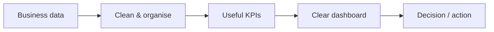

# Jefferson Mawapanga Saku — Power BI Portfolio

[GitHub profile](https://github.com/jeffersonkuku) · [Power Platform portfolio](https://github.com/jeffersonkuku/jefferson-Mawapanga-Saku)

---

## 🇬🇧 English

### 30-second overview

I use Power BI to turn business data into dashboards that answer:

**What is happening? → Where is the problem? → What needs attention?**

### Main projects

#### Procurement & Financial Control Tower

**Question:** Are budget, spend, commitments and supplier risk under control?

**[Open project →](./powerbi-procurement-financial-control-tower/)**

#### SLA & Penalties Operations

**Question:** Are service commitments being met, and where is the operational risk?

**[Open project →](./powerbi-sla-penalties-portfolio/)**

#### P2 Financial Monitoring

**Question:** How much has been ordered, invoiced and consumed versus budget?

**[Open project →](./powerbi-p2-consumables-financial-monitoring/)**

### Other projects

- **[Financial Pilotage](./powerbi-financial-pilotage-portfolio/)**
- **[Procurement & Budget](./powerbi-procurement-budget-portfolio/)**

---

## 🇫🇷 Français

### Vue en 30 secondes

J’utilise Power BI pour transformer les données métier en tableaux de bord qui répondent à trois questions :

**Que se passe-t-il ? → Où est le problème ? → Que faut-il regarder en priorité ?**

### Projets principaux

#### Procurement & Financial Control Tower

**Question :** le budget, les dépenses, les engagements et les risques fournisseurs sont-ils sous contrôle ?

**[Voir le projet →](./powerbi-procurement-financial-control-tower/)**

#### SLA & Penalties Operations

**Question :** les engagements de service sont-ils respectés et où se trouve le risque opérationnel ?

**[Voir le projet →](./powerbi-sla-penalties-portfolio/)**

#### P2 Financial Monitoring

**Question :** combien a été commandé, facturé et consommé par rapport au budget ?

**[Voir le projet →](./powerbi-p2-consumables-financial-monitoring/)**

### Autres projets

- **[Financial Pilotage](./powerbi-financial-pilotage-portfolio/)**
- **[Procurement & Budget](./powerbi-procurement-budget-portfolio/)**

---

Les détails DAX, Power Query, modèle et validation restent dans chaque projet, pas sur cette page d’accueil.
