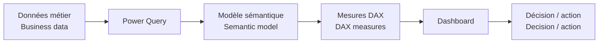
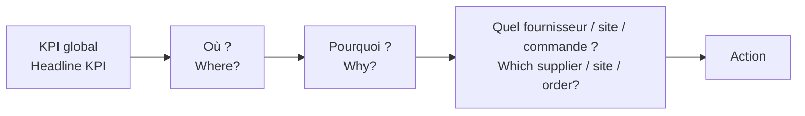

# Jefferson Mawapanga Saku — Power BI Portfolio

[👤 Profil / Profile](https://github.com/jeffersonkuku) · [⚡ Power Platform](https://github.com/jeffersonkuku/jefferson-Mawapanga-Saku)

> 🇫🇷 **Je transforme des données achats, financières et opérationnelles en tableaux de bord qui montrent ce qui se passe, où se trouve le problème et ce qu’il faut regarder en priorité.**  
> *🇬🇧 I turn procurement, financial and operational data into dashboards that show what is happening, where the problem is and what needs attention first.*

## ⚡ Comprendre en 30 secondes / Understand in 30 seconds

## 📊 Tous les projets Power BI / All Power BI projects

<table>
<tr><td width="33%" valign="top"> <strong>Procurement & Financial Control Tower</strong> 🇫🇷 Réunir budget, dépenses, engagements, fournisseurs et exceptions. <em>🇬🇧 Bring budget, spend, commitments, suppliers and exceptions together.</em>  <code>Budget → dépenses → engagements → risque</code>  <a href="./powerbi-procurement-financial-control-tower/"><strong>Voir / Open →</strong></a></td><td width="33%" valign="top"> <strong>SLA & Penalties Operations</strong> 🇫🇷 Mesurer la conformité SLA, les retards, le backlog et le risque contractuel. <em>🇬🇧 Measure SLA compliance, delays, backlog and contractual risk.</em>  <code>Interventions → SLA → écarts → risque</code>  <a href="./powerbi-sla-penalties-portfolio/"><strong>Voir / Open →</strong></a></td><td width="33%" valign="top"> <strong>P2 Financial Monitoring</strong> 🇫🇷 Suivre commandes, facturation, sous-traitance et budgets. <em>🇬🇧 Track orders, invoicing, subcontracting and budgets.</em>  <code>Commandé → facturé → consommé → restant</code>  <a href="./powerbi-p2-consumables-financial-monitoring/"><strong>Voir / Open →</strong></a></td></tr><tr><td width="33%" valign="top"> <strong>Financial Pilotage</strong> 🇫🇷 Passer du pilotage financier global au détail de la commande. <em>🇬🇧 Move from financial steering to individual purchase-order detail.</em>  <code>Budget → fournisseurs → commandes → détail</code>  <a href="./powerbi-financial-pilotage-portfolio/"><strong>Voir / Open →</strong></a></td><td width="33%" valign="top"> <strong>Procurement & Budget</strong> 🇫🇷 Piloter les achats récents, récurrents et la consommation du budget. <em>🇬🇧 Monitor recent, recurring purchases and budget consumption.</em>  <code>Budget → commandes → consommé → restant</code>  <a href="./powerbi-procurement-budget-portfolio/"><strong>Voir / Open →</strong></a></td><td></td></tr>
</table>

## 🧠 Ma logique d’analyse / My analytical logic

🇫🇷 Un bon dashboard ne montre pas seulement des chiffres : il permet de passer **du signal → à l’explication → au détail qui permet d’agir**.  
*🇬🇧 A good dashboard does not only show numbers: it lets the user move **from signal → to explanation → to the detail needed for action**.*

## 🔎 Ce que les pages projets détaillent / What project pages explain

🇫🇷 Pour chaque écran : la question métier, ce que montre le visuel, comment lire l’information, puis le flux technique complet.  
*🇬🇧 For every screen: the business question, what the visual shows, how to read it, then the complete technical flow.*

**Power BI Desktop · Power Query · DAX · Semantic modelling · PBIP · PBIR · TMDL**
