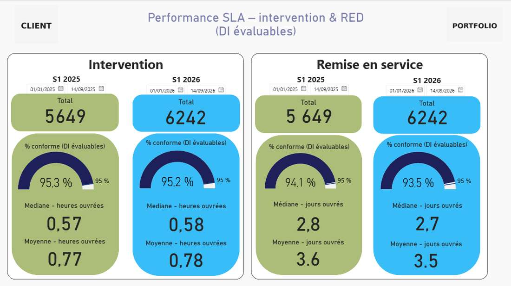
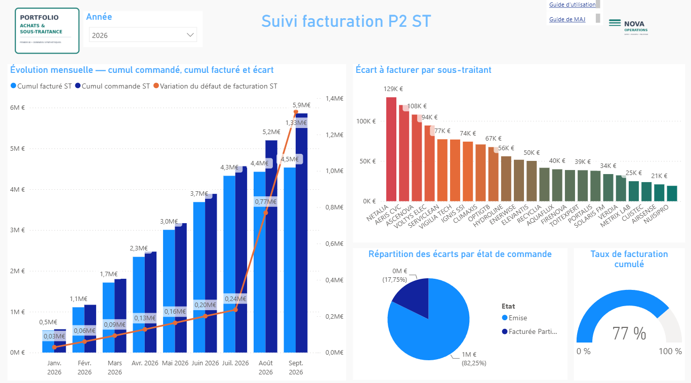
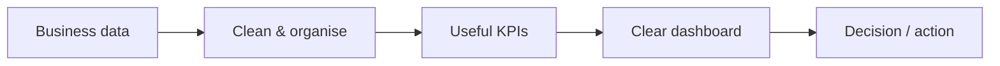

# Jefferson Mawapanga Saku — Power BI Portfolio

[GitHub profile](https://github.com/jeffersonkuku) · [Power Platform portfolio](https://github.com/jeffersonkuku/jefferson-Mawapanga-Saku)

---

## 🇬🇧 English

### 30-second overview

I use Power BI to answer one simple sequence:

**What is happening? → Where is the problem? → What needs attention?**

<table>
<tr>
<td width="33%" valign="top">

 <strong>Procurement Control Tower</strong> 
Budget, spend, commitments and supplier risk.
  <a href="./powerbi-procurement-financial-control-tower/"><strong>Open project →</strong></a>
</td>
<td width="33%" valign="top">

 <strong>SLA & Penalties</strong> 
Service performance, backlog and operational risk.
  <a href="./powerbi-sla-penalties-portfolio/"><strong>Open project →</strong></a>
</td>
<td width="33%" valign="top">

 <strong>P2 Financial Monitoring</strong> 
Orders, invoices, subcontracting and budgets.
  <a href="./powerbi-p2-consumables-financial-monitoring/"><strong>Open project →</strong></a>
</td>
</tr>
</table>

### Other projects

- **[Financial Pilotage](./powerbi-financial-pilotage-portfolio/)**
- **[Procurement & Budget](./powerbi-procurement-budget-portfolio/)**

---

## 🇫🇷 Français

### Vue en 30 secondes

J’utilise Power BI pour répondre à une logique simple :

**Que se passe-t-il ? → Où est le problème ? → Que faut-il regarder en priorité ?**

| Projet | Question principale |
|---|---|
| **[Procurement Control Tower](./powerbi-procurement-financial-control-tower/)** | Budget, dépenses, engagements et risques fournisseurs sont-ils sous contrôle ? |
| **[SLA & Penalties](./powerbi-sla-penalties-portfolio/)** | Les engagements de service sont-ils respectés et où se trouve le risque ? |
| **[P2 Financial Monitoring](./powerbi-p2-consumables-financial-monitoring/)** | Combien a été commandé, facturé et consommé par rapport au budget ? |

### Autres projets

- **[Financial Pilotage](./powerbi-financial-pilotage-portfolio/)**
- **[Procurement & Budget](./powerbi-procurement-budget-portfolio/)**

Les détails DAX, Power Query, modèle et validation sont disponibles seulement après ouverture d’un projet.
