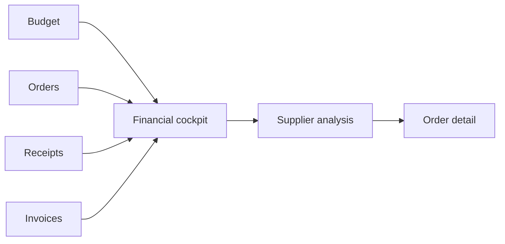
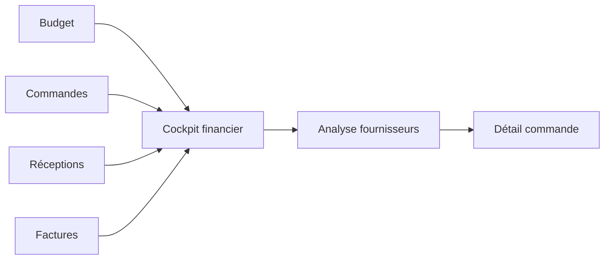

# Financial Pilotage

[← Power BI portfolio](../README.md)

---

## 🇬🇧 English

### Understand it in 30 seconds

**Problem:** financial totals are difficult to explain without linking them to suppliers and individual purchase orders.

**Solution:** a report that goes from the overall financial position down to the transaction that explains it.

### Main views

---

## 🇫🇷 Français

### Comprendre le projet en 30 secondes

**Problème :** les totaux financiers sont difficiles à expliquer sans les relier aux fournisseurs et aux commandes individuelles.

**Solution :** un rapport qui part de la vision financière globale et descend jusqu’à la transaction qui explique l’écart.

