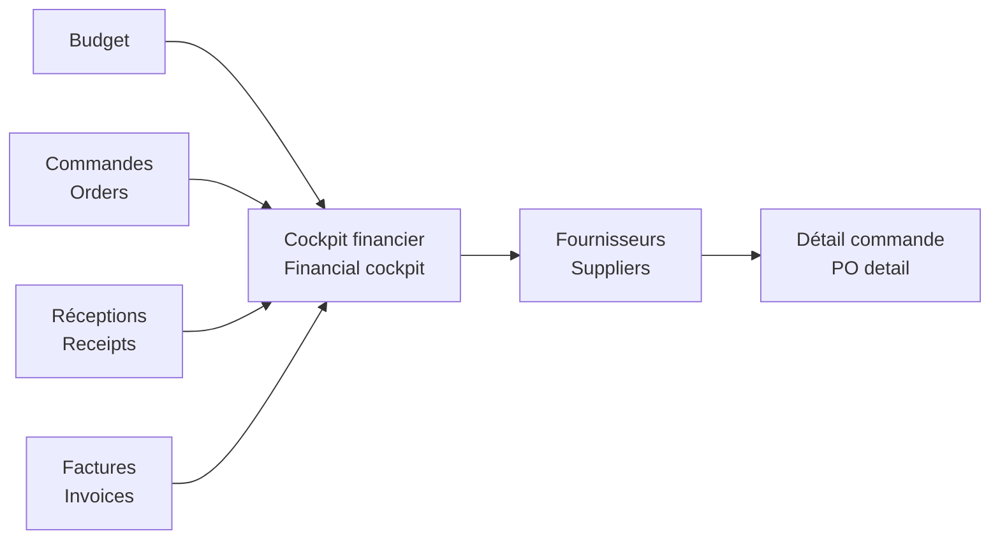
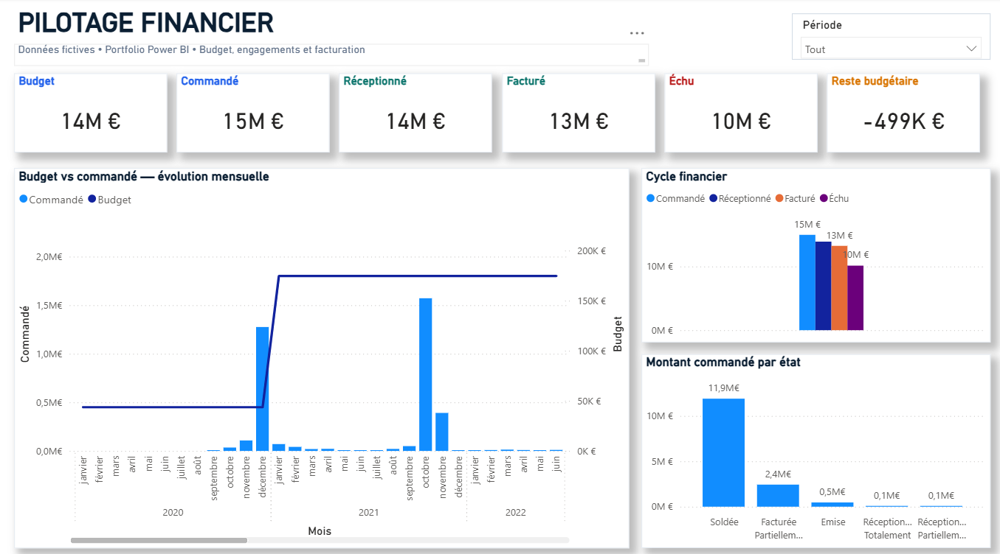
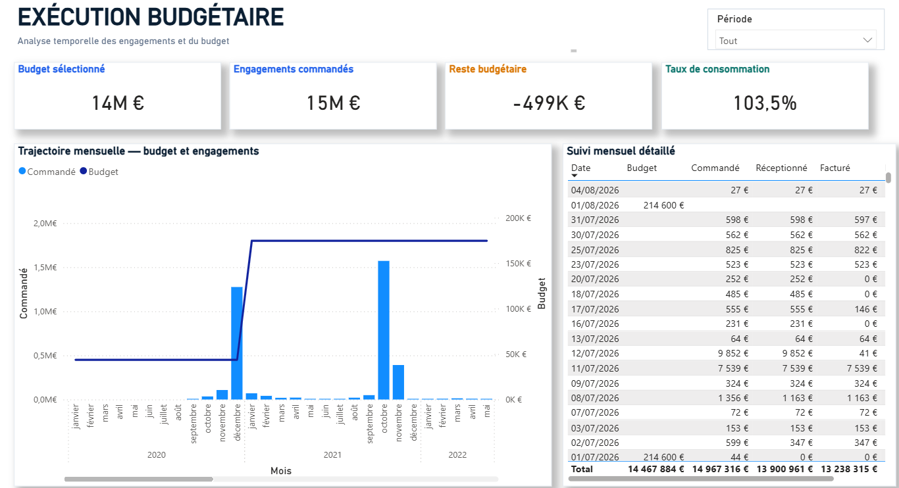
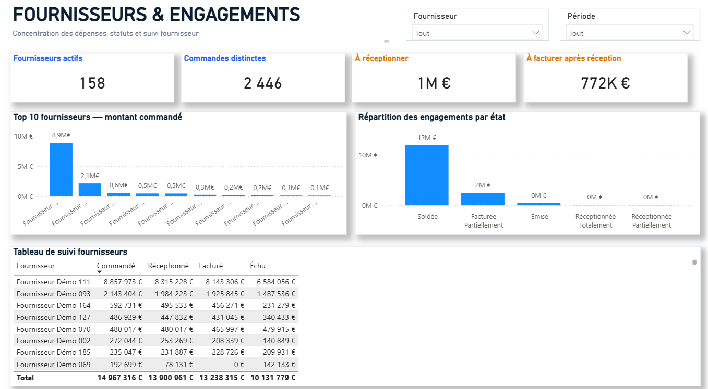
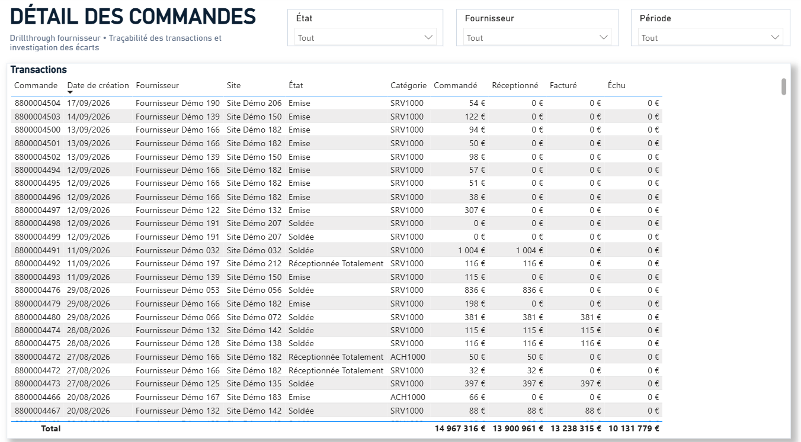
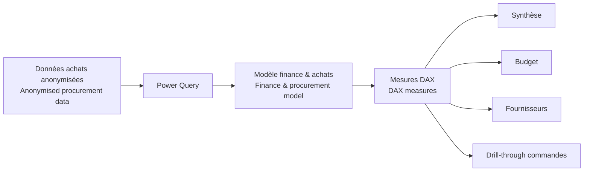

# Financial Pilotage

[← Portfolio Power BI](../README.md)

> 🇫🇷 **Un tableau de bord financier qui permet de partir de la position globale et de descendre jusqu’à la commande qui explique l’écart.**  
> *🇬🇧 A financial dashboard that moves from the overall position down to the purchase order explaining the variance.*

## ⚡ Comprendre en 30 secondes / Understand in 30 seconds

# Parcours des écrans / Screen walkthrough

## 1. Synthèse financière / Financial overview

🇫🇷 Cette page donne la position globale : budget, commandé, réceptionné, facturé, échus et reste budgétaire. Elle sert de point de départ avant toute investigation.  
*🇬🇧 This page gives the overall position: budget, ordered, received, invoiced, overdue and remaining budget. It is the starting point before investigation.*

## 2. Exécution budgétaire / Budget execution

🇫🇷 La consommation est suivie dans le temps pour voir si les engagements progressent au rythme attendu et quelles périodes créent une pression budgétaire.  
*🇬🇧 Consumption is tracked over time to see whether commitments progress at the expected pace and which periods create budget pressure.*

## 3. Fournisseurs & engagements / Suppliers & commitments

🇫🇷 La vue fournisseurs montre où se concentrent les montants, quelles commandes restent à réceptionner ou à facturer et quels fournisseurs nécessitent une attention particulière.  
*🇬🇧 The supplier view shows where value is concentrated, which orders still need receipt or invoicing and which suppliers require attention.*

## 4. Détail des commandes / Purchase-order detail

🇫🇷 Le drill-through permet de passer d’un indicateur agrégé au détail transactionnel qui explique le résultat : fournisseur, période, statut et commande.  
*🇬🇧 Drill-through moves from an aggregated indicator to transaction detail explaining the result: supplier, period, status and purchase order.*

# 🧩 Flux analytique / Analytical flow

🇫🇷 Cette structure permet de commencer par le management puis d’investiguer sans changer d’outil.  
*🇬🇧 This structure starts with management-level reading and then supports investigation without changing tools.*

## 🔎 Détail technique / Technical detail

**Power BI Desktop · Power Query · DAX · drill-through · analyse fournisseurs / supplier analysis**
