# P2 Financial Monitoring

[← Portfolio Power BI](../README.md)

> 🇫🇷 **Un reporting financier qui relie achats, sous-traitance, facturation et budgets dans un modèle commun.**  
> *🇬🇧 A financial-monitoring report connecting procurement, subcontracting, invoicing and budgets in one model.*

## ⚡ Comprendre en 30 secondes / Understand in 30 seconds

**🇫🇷 Problème :** commandes, factures et budgets séparés rendent difficile la lecture du consommé, du restant et des écarts.  
*🇬🇧 Problem: separate orders, invoices and budgets make consumption, remaining capacity and gaps difficult to understand.*

**🇫🇷 Solution :** un calendrier et un modèle communs pour suivre les mêmes indicateurs sur achats et sous-traitance.  
*🇬🇧 Solution: one shared calendar and model to track consistent indicators across procurement and subcontracting.*

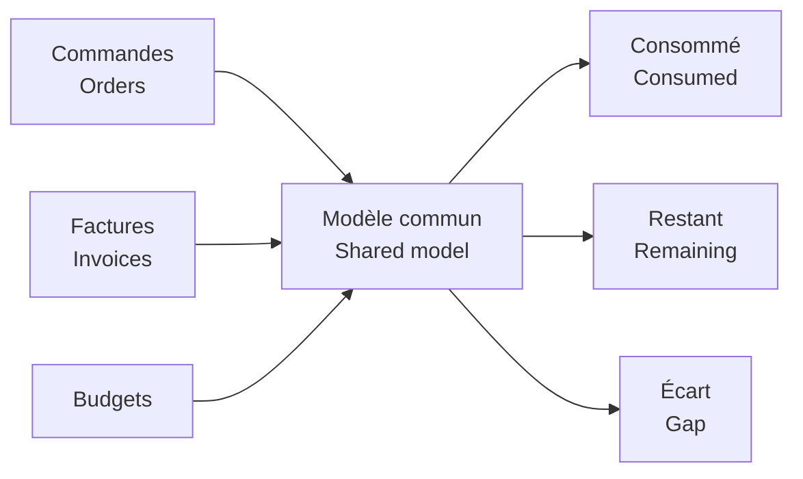

# Parcours des écrans / Screen walkthrough

## 1. Synthèse facturation sous-traitance / Subcontracting invoicing overview

🇫🇷 Cette page compare montants commandés et facturés, suit les cumuls et met en évidence l’écart de facturation restant. Elle donne immédiatement la position globale du portefeuille sous-traitance.  
*🇬🇧 This page compares ordered and invoiced amounts, tracks cumulative values and highlights the remaining invoicing gap. It gives the overall subcontracting position immediately.*

## 2. Consommation budget sous-traitance / Subcontracting budget consumption

<a href="./assets/02-subcontracting-budget-consumption.png">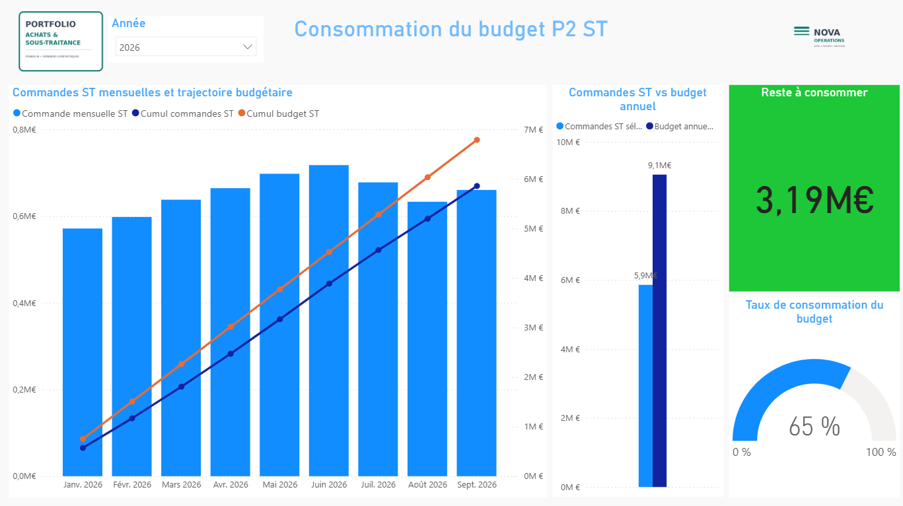</a>

🇫🇷 Les engagements mensuels sont comparés au budget annuel et à une trajectoire cumulée. Le management voit le taux de consommation et le budget restant.  
*🇬🇧 Monthly commitments are compared with the annual budget and cumulative trajectory. Management can see consumption rate and remaining budget.*

## 3. Consommation budget achats / Procurement budget consumption

<a href="./assets/03-procurement-budget-consumption.png">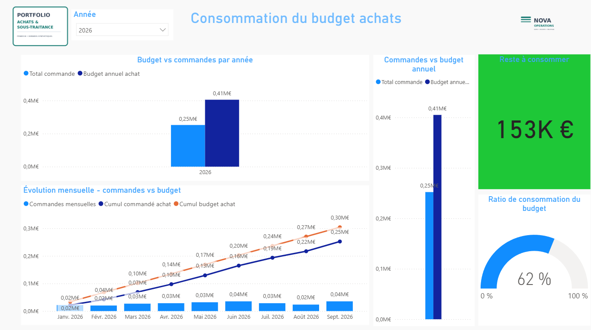</a>

🇫🇷 La même logique est appliquée aux achats : budget, commandé, évolution mensuelle, cumul et capacité restante.  
*🇬🇧 The same logic is applied to procurement: budget, ordered amount, monthly evolution, cumulative position and remaining capacity.*

## 4. Portefeuille sous-traitants / Subcontractor portfolio overview

<a href="./assets/04-subcontractor-portfolio-overview.png">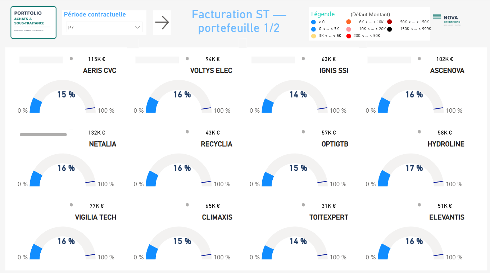</a>

🇫🇷 Cette vue compare les sous-traitants afin d’identifier ceux qui concentrent les plus gros engagements ou les écarts de facturation les plus importants.  
*🇬🇧 This view compares subcontractors to identify those with the largest commitments or biggest invoicing gaps.*

## 5. Détail sous-traitant / Subcontractor portfolio detail

<a href="./assets/05-subcontractor-portfolio-detail.png">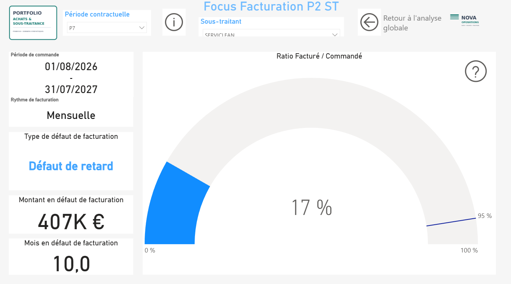</a>

🇫🇷 Le détail descend au niveau d’un fournisseur pour analyser sa position financière, sa progression de facturation et son exposition restante.  
*🇬🇧 The detail view drills into one supplier to analyse financial position, invoicing progress and remaining exposure.*

## 6. Focus facturation / Invoicing focus

<a href="./assets/06-invoicing-focus.png">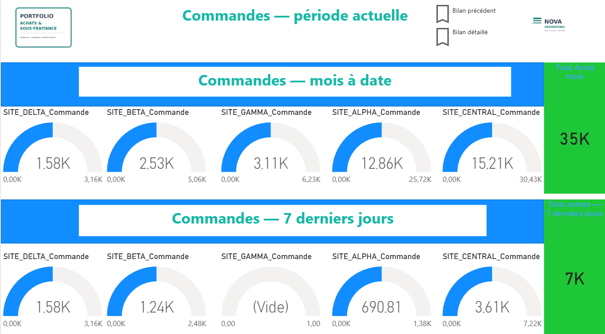</a>

🇫🇷 Cette page concentre l’analyse sur un sous-traitant et une période : ratio facturé/commandé, évolution mensuelle et écart restant.  
*🇬🇧 This page focuses on one subcontractor and period: invoiced/ordered ratio, monthly evolution and remaining gap.*

## 7. Revue mensuelle des commandes / Monthly orders review

<a href="./assets/07-monthly-orders-review.png">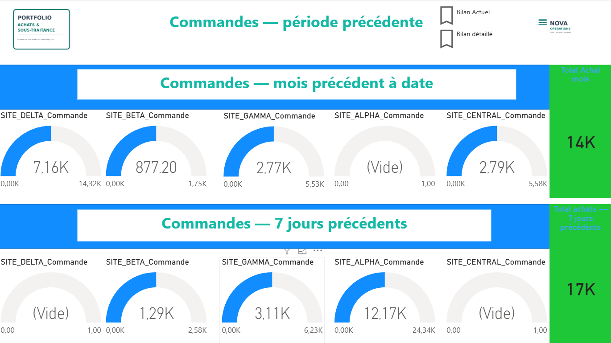</a>

🇫🇷 La revue mensuelle relie KPI de période et détail transactionnel. Elle permet de comprendre les commandes récentes plutôt que de rester uniquement sur des cumuls annuels.  
*🇬🇧 The monthly review connects period KPIs with transaction detail. It explains recent orders instead of staying only at annual cumulative level.*

## 8. Comparaison de périodes / Period comparison

<a href="./assets/08-period-comparison.png">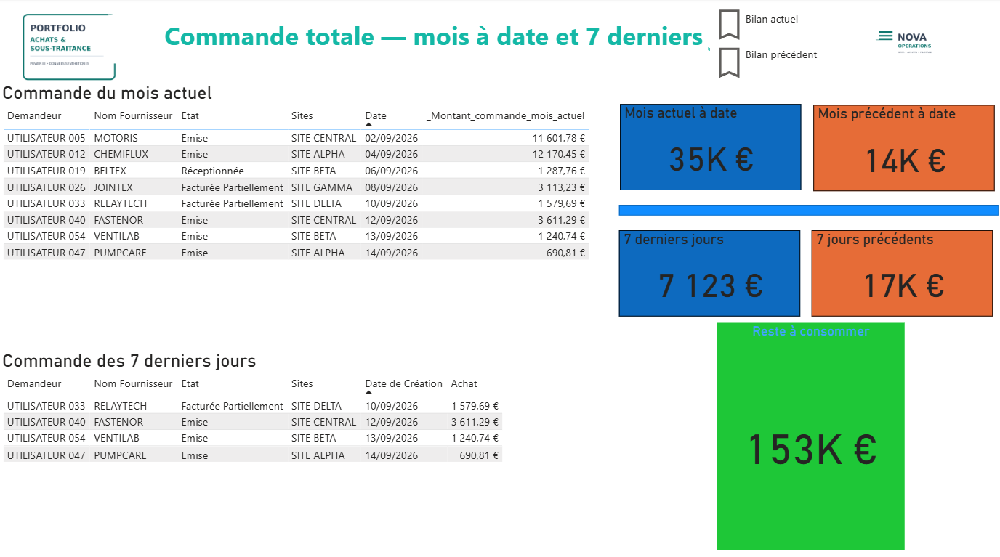</a>

🇫🇷 La comparaison de périodes met en regard la période courante avec une période comparable afin d’éviter des conclusions faussées par le calendrier.  
*🇬🇧 Period comparison contrasts the current period with a comparable period to avoid conclusions distorted by calendar effects.*

## 9. Analyse consommables / Consumables analysis

<a href="./assets/09-consumables-analysis.png">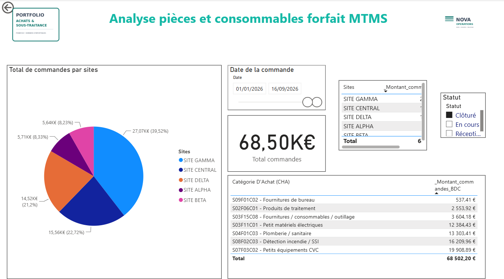</a>

🇫🇷 Les consommables sont analysés par site, état et catégorie avec montant, nombre de lignes, panier moyen et évolution mensuelle.  
*🇬🇧 Consumables are analysed by site, status and category with amount, line count, average basket and monthly evolution.*

## 10. Petits achats / Small purchases

<a href="./assets/10-small-purchases-analysis.png">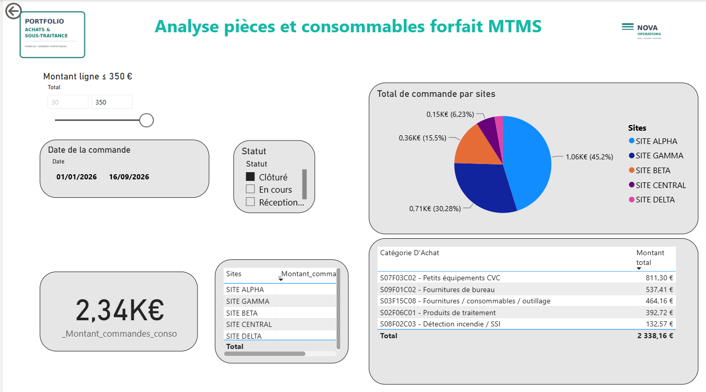</a>

🇫🇷 Une vue dédiée isole les achats de faible valeur afin de suivre leur volume, montant, panier moyen, taux de clôture et répartition.  
*🇬🇧 A dedicated view isolates low-value purchases to track volume, spend, average basket, closure rate and distribution.*

# 🧩 Architecture analytique / Analytical architecture

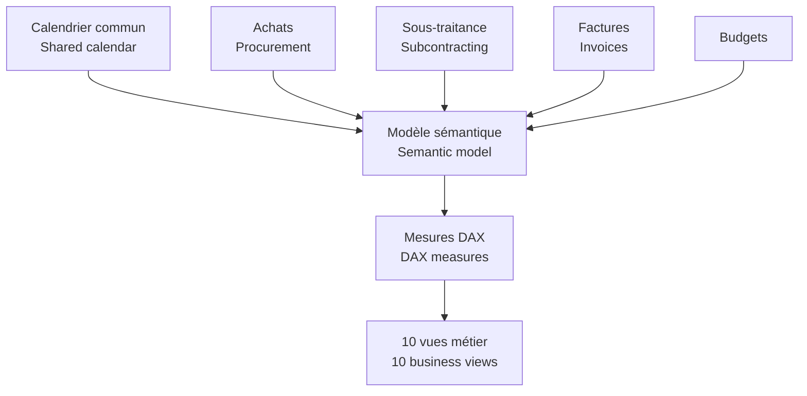

🇫🇷 Le calendrier commun permet qu’un filtre année/période agisse de manière cohérente sur achats, sous-traitance, facturation et budget.  
*🇬🇧 The shared calendar lets year/period filters act consistently across procurement, subcontracting, invoicing and budget.*

## 🔎 Détails techniques / Technical deep dive

- [Méthodologie des données / Data methodology](./docs/DATA_METHODOLOGY_FR.md)
- [Validation](./docs/VALIDATION.md)
- [Projet PBIP / PBIP project](./dashboard/P2_Consumables_Financial_Monitoring.pbip)

🇫🇷 Les données publiques sont anonymisées/synthétiques et servent à préserver la logique analytique sans exposer la production.  
*🇬🇧 Public data is anonymised/synthetic and preserves the analytical logic without exposing production records.*
