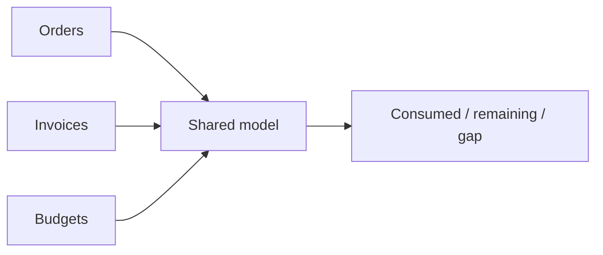
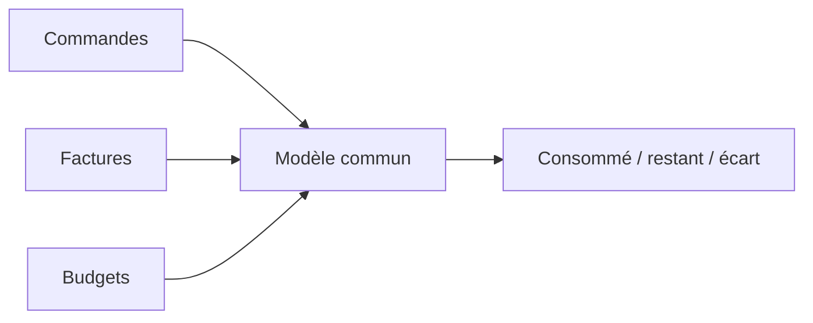

# P2 Financial Monitoring

[← Power BI portfolio](../README.md)

---

## 🇬🇧 English

### Understand it in 30 seconds

**Problem:** orders, subcontracting, invoices and budgets are difficult to follow when they live in separate files.

**Solution:** one report that compares what is ordered, invoiced and still available.

### Visual gallery — click to enlarge

<table>
<tr>
<td width="33%"> <b>Invoicing</b></td>
<td width="33%"> <b>Subcontracting budget</b></td>
<td width="33%"> <b>Procurement budget</b></td>
</tr>
<tr>
<td> <b>Supplier portfolio</b></td>
<td> <b>Supplier detail</b></td>
<td> <b>Invoicing focus</b></td>
</tr>
<tr>
<td> <b>Monthly review</b></td>
<td> <b>Period comparison</b></td>
<td> <b>Consumables</b></td>
</tr>
<tr>
<td> <b>Small purchases</b></td>
<td></td><td></td>
</tr>
</table>

### Technical detail

- **[Data methodology →](./docs/DATA_METHODOLOGY_EN.md)**
- **[Validation →](./docs/VALIDATION.md)**

---

## 🇫🇷 Français

### Comprendre le projet en 30 secondes

**Problème :** commandes, sous-traitance, factures et budgets sont difficiles à suivre lorsqu’ils sont séparés.

**Solution :** un rapport unique qui compare ce qui est commandé, facturé et encore disponible.

Les **10 captures ci-dessus** sont cliquables.

### Détail technique

- **[Méthodologie des données →](./docs/DATA_METHODOLOGY_FR.md)**
- **[Validation →](./docs/VALIDATION.md)**
