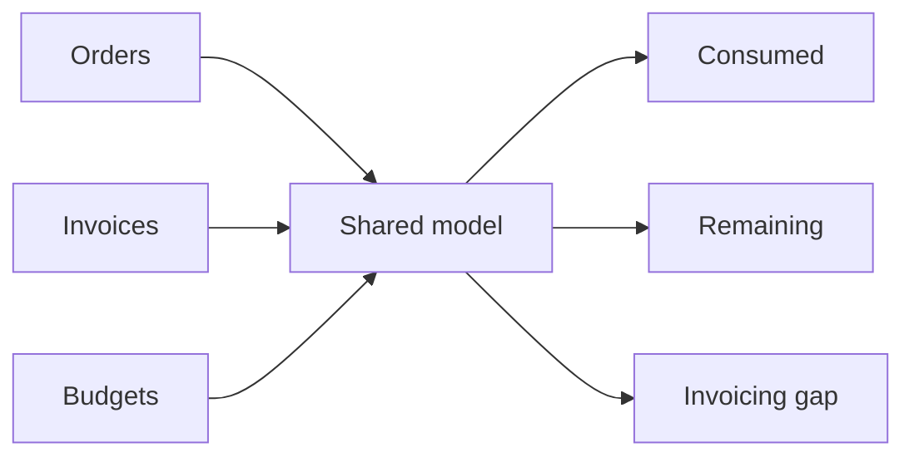
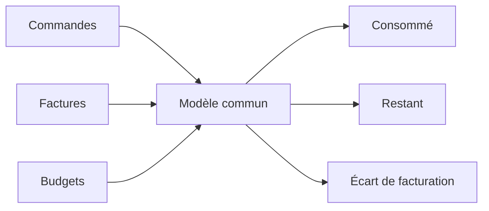

# P2 Financial Monitoring

[← Power BI portfolio](../README.md)

---

## 🇬🇧 English

### Understand it in 30 seconds

**Problem:** orders, subcontracting, invoices and budgets are difficult to follow when they live in separate files.

**Solution:** one report that compares what is ordered, invoiced and still available.

### How it works

### Main views

### Technical detail

- **[Data methodology →](./docs/DATA_METHODOLOGY_EN.md)**
- **[Validation →](./docs/VALIDATION.md)**
- **[Power BI project →](./dashboard/P2_Consumables_Financial_Monitoring.pbip)**

---

## 🇫🇷 Français

### Comprendre le projet en 30 secondes

**Problème :** commandes, sous-traitance, factures et budgets sont difficiles à suivre lorsqu’ils sont séparés dans plusieurs fichiers.

**Solution :** un seul rapport qui compare ce qui est commandé, facturé et encore disponible.

### Fonctionnement

### Détail technique

- **[Méthodologie des données →](./docs/DATA_METHODOLOGY_FR.md)**
- **[Validation →](./docs/VALIDATION.md)**
- **[Projet Power BI →](./dashboard/P2_Consumables_Financial_Monitoring.pbip)**
