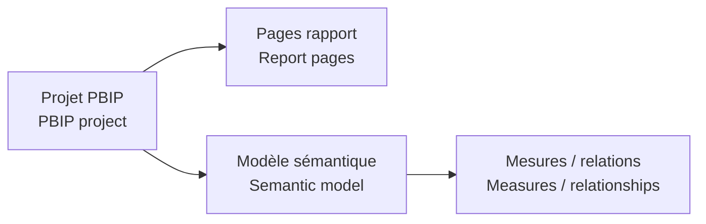

# Fichiers Power BI P2 / P2 Power BI Files

[← Projet / Project](../README.md)

**🇫🇷 Fichier principal :** `P2_Consumables_Financial_Monitoring.pbip`  
*🇬🇧 Main file: `P2_Consumables_Financial_Monitoring.pbip`*

