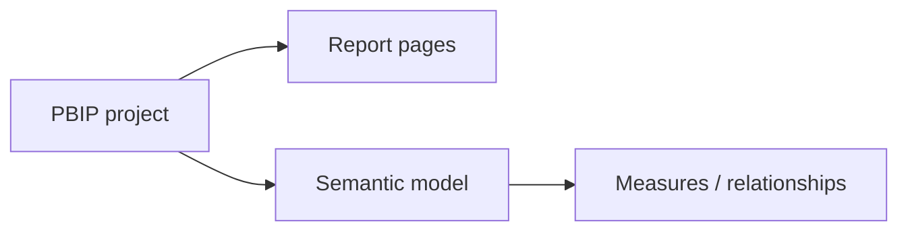
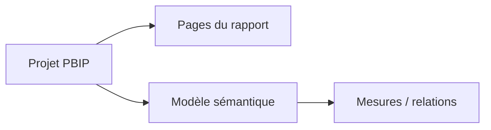

# Power BI Project Files — P2

[← Project](../README.md)

---

## 🇬🇧 English

**Main file:** `P2_Consumables_Financial_Monitoring.pbip`

---

## 🇫🇷 Français

**Fichier principal :** `P2_Consumables_Financial_Monitoring.pbip`

