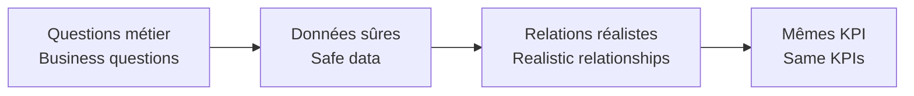

# Données P2 / P2 Data

[← Projet / Project](../README.md)

🇫🇷 Les données publiques sont anonymisées ou synthétiques pour reproduire les relations nécessaires entre commandes, fournisseurs, sous-traitance, factures, budgets et périodes sans exposer la production.  
*🇬🇧 Public data is anonymised or synthetic to reproduce the relationships needed across orders, suppliers, subcontracting, invoices, budgets and periods without exposing production data.*

