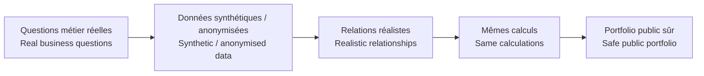

# Méthodologie des données / Data Methodology

[← Projet / Project](../README.md)

## 🎯 Objectif / Goal

🇫🇷 Conserver un comportement achats/sous-traitance réaliste sans reproduire de vrais enregistrements fournisseurs.  
*🇬🇧 Preserve realistic procurement/subcontracting behaviour without reproducing real supplier records.*

- 🇫🇷 Fournisseurs, sites et identifiants sont fictifs ou anonymisés.  
  *🇬🇧 Suppliers, sites and identifiers are fictitious or anonymised.*
- 🇫🇷 Les montants sont calibrés pour produire un comportement crédible sans recopier la production.  
  *🇬🇧 Amounts are calibrated to create credible behaviour without copying production.*
- 🇫🇷 Un calendrier commun garantit des filtres cohérents sur achats, sous-traitance, factures et budgets.  
  *🇬🇧 A shared calendar keeps filters consistent across procurement, subcontracting, invoices and budgets.*
- 🇫🇷 Une date de coupure empêche de traiter des lignes futures de démonstration comme des activités déjà réalisées.  
  *🇬🇧 A snapshot cutoff prevents future demonstration rows from being treated as completed activity.*
