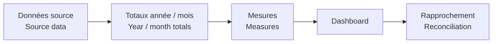

# Validation P2

[← Projet / Project](../README.md)

- 🇫🇷 Rapprochement des totaux achats annuels.  
  *🇬🇧 Reconcile yearly procurement totals.*
- 🇫🇷 Rapprochement sous-traitance commandé / facturé.  
  *🇬🇧 Reconcile subcontracting ordered vs invoiced.*
- 🇫🇷 Vérification consommation et reste budgétaire.  
  *🇬🇧 Check budget consumption and remaining budget.*
- 🇫🇷 Vérification du calendrier commun et des comparaisons de périodes.  
  *🇬🇧 Check the shared calendar and period comparisons.*
- 🇫🇷 Contrôles mensuels sur les séries de sous-traitance.  
  *🇬🇧 Monthly checks on subcontracting series.*

🇫🇷 Les chiffres publics servent à la démonstration et aux tests, pas à représenter des valeurs confidentielles.  
*🇬🇧 Public figures are used for demonstration and testing, not to represent confidential values.*
