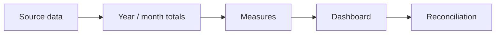
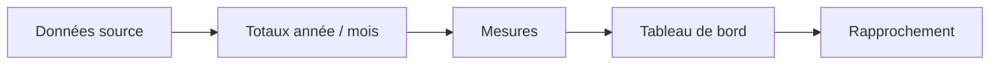

# Validation — P2 Financial Monitoring

[← Project](../README.md)

---

## 🇬🇧 English

### What is checked?

Checks cover yearly totals, invoicing vs orders, budget consumption, remaining budget, shared-calendar filtering and comparable-period logic.

---

## 🇫🇷 Français

### Qu’est-ce qui est contrôlé ?

Les contrôles couvrent les totaux annuels, facturation vs commandes, consommation budgétaire, budget restant, filtres calendaires et comparaisons de périodes.
