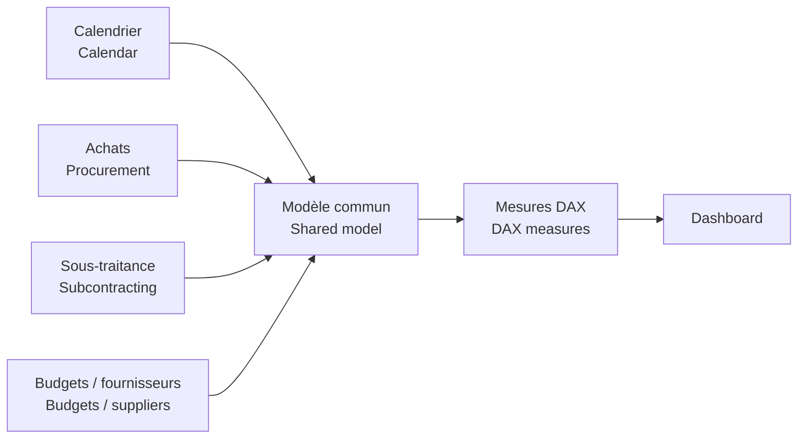

# Modèle sémantique P2 / P2 Semantic Model

[← Projet / Project](../README.md)

🇫🇷 Le modèle permet qu’un même filtre période, fournisseur ou année soit interprété de manière cohérente dans tout le rapport.  
*🇬🇧 The model ensures the same period, supplier or year filter is interpreted consistently across the report.*
