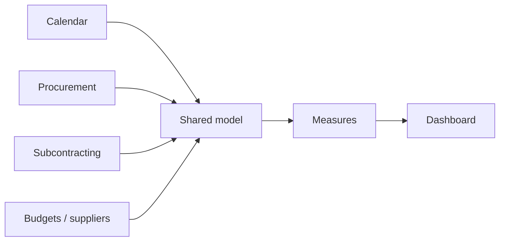
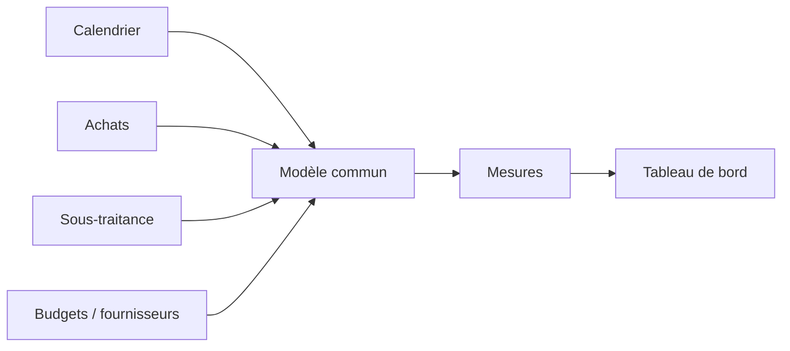

# Semantic Model — P2 Financial Monitoring

[← Project](../README.md)

---

## 🇬🇧 English

The model connects the different business topics so one filter can be understood consistently across the report.

---

## 🇫🇷 Français

Le modèle relie les différents sujets métier afin qu’un même filtre soit cohérent dans tout le rapport.
