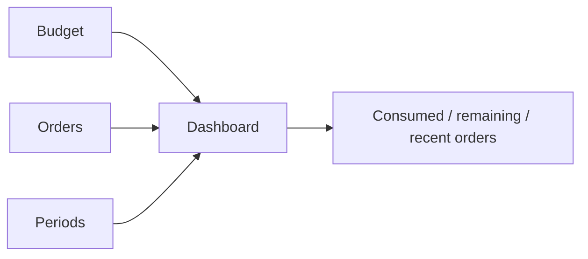
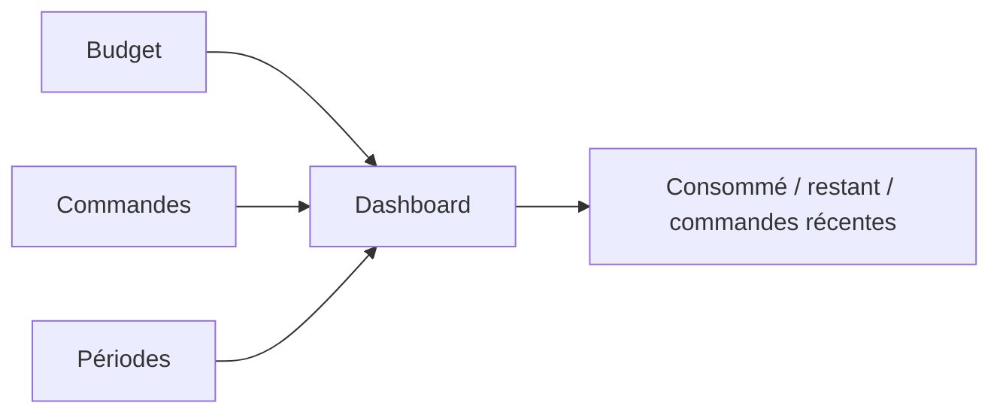

# Procurement & Budget

[← Power BI portfolio](../README.md)

---

## 🇬🇧 English

### 30-second overview

**Problem:** purchasing activity and budget consumption are hard to control when monthly and recurring orders are viewed separately.

**Solution:** one dashboard showing consumed budget, remaining budget and the orders behind it.

<table>
<tr>
<td width="33%"> <b>Budget</b></td>
<td width="33%"> <b>Recent orders</b></td>
<td width="33%"> <b>Recurring orders</b></td>
</tr>
</table>

---

## 🇫🇷 Français

### Vue en 30 secondes

**Problème :** l’activité achats et la consommation budgétaire sont difficiles à piloter lorsque les commandes mensuelles et récurrentes sont vues séparément.

**Solution :** un dashboard unique montrant le budget consommé, le budget restant et les commandes qui l’expliquent.

