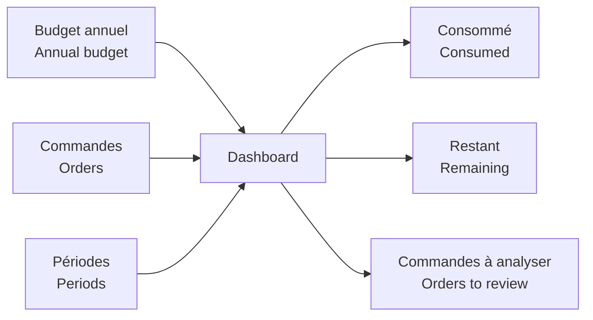
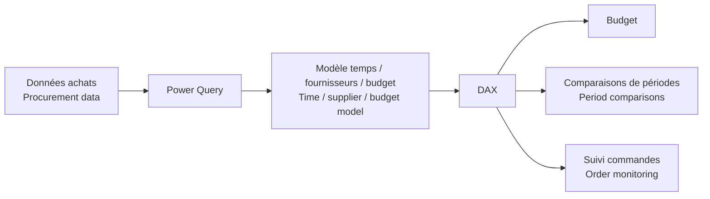

# Procurement & Budget

[← Portfolio Power BI](../README.md)

> 🇫🇷 **Un dashboard achats pour suivre la consommation du budget et comprendre quelles commandes récentes ou récurrentes l’expliquent.**  
> *🇬🇧 A procurement dashboard for tracking budget consumption and understanding which recent or recurring orders explain it.*

## ⚡ Comprendre en 30 secondes / Understand in 30 seconds

# Parcours des écrans / Screen walkthrough

## 1. Budget consommables / Consumables budget

🇫🇷 Cette vue compare l’activité mensuelle au budget annuel, affiche le reste disponible et le taux de consommation afin de détecter rapidement une dérive.  
*🇬🇧 This view compares monthly activity with the annual budget, shows remaining capacity and consumption rate to quickly detect drift.*

## 2. Bilan hebdomadaire & mensuel / Weekly & monthly review

🇫🇷 Le suivi récent relie les KPI de période aux commandes fournisseur par fournisseur. Il permet de comprendre ce qui vient de se passer et pas seulement le cumul annuel.  
*🇬🇧 Recent monitoring connects period KPIs with supplier-level orders. It explains what just happened instead of only showing annual totals.*

## 3. Commandes récurrentes / de durée / Recurring / duration-based orders

🇫🇷 Cette vue applique la même logique à des engagements plus longs : montants mensuels, budget annuel, reste disponible et taux de consommation.  
*🇬🇧 This view applies the same logic to longer commitments: monthly ordered amounts, annual budget, remaining capacity and consumption rate.*

# 🧩 Architecture analytique / Analytical architecture

🇫🇷 Le même modèle analytique est réutilisé pour différents types d’achats afin de garder des KPI cohérents.  
*🇬🇧 The same analytical model is reused across purchasing categories to keep KPIs consistent.*
