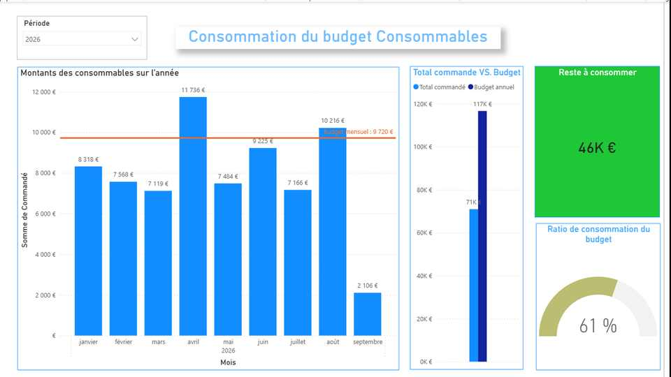
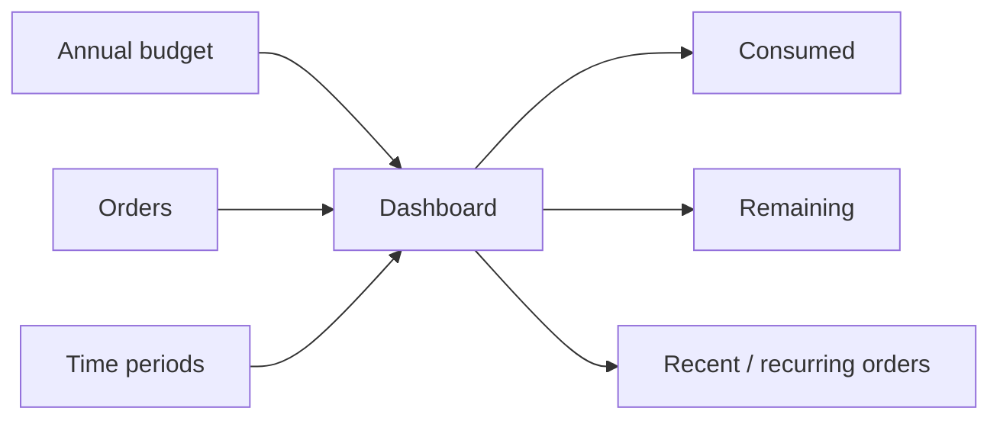
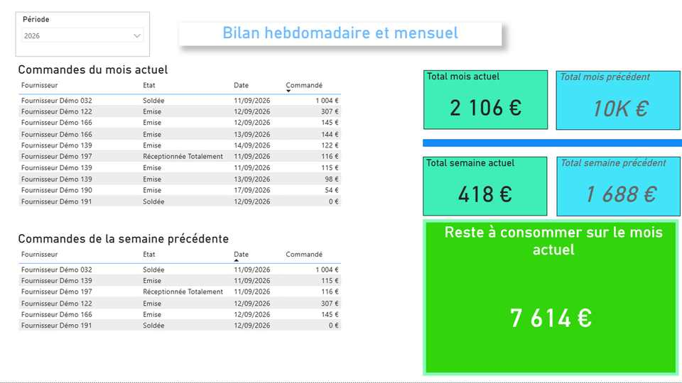
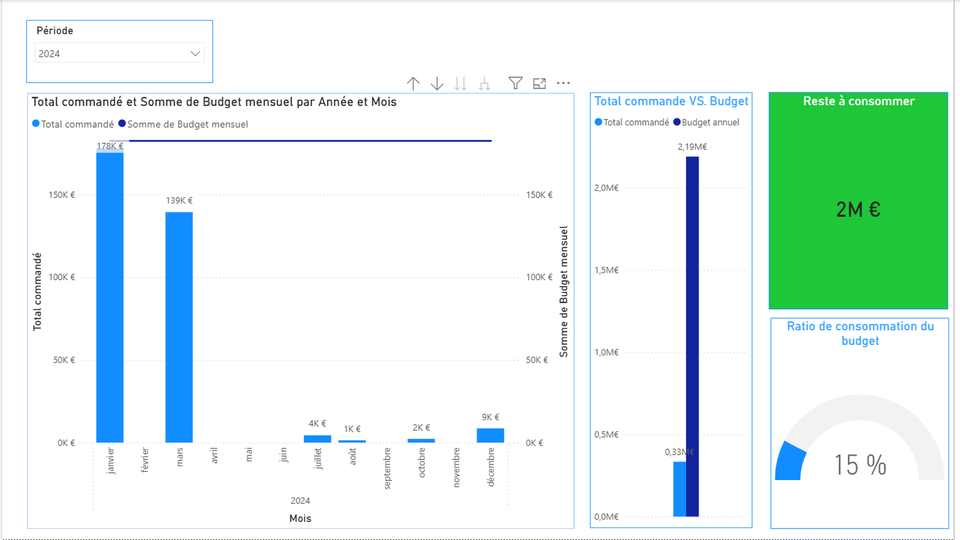
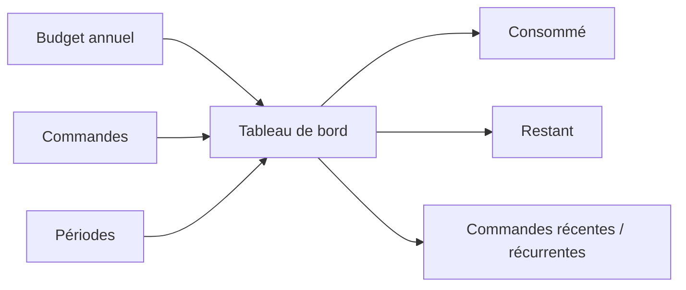

# Procurement & Budget

[← Power BI portfolio](../README.md)

---

## 🇬🇧 English

### Understand it in 30 seconds

**Problem:** purchasing activity and budget consumption are hard to control when monthly and recurring orders are viewed separately.

**Solution:** one dashboard that shows consumed budget, remaining budget and the orders behind it.

### Main views

---

## 🇫🇷 Français

### Comprendre le projet en 30 secondes

**Problème :** l’activité achats et la consommation du budget sont difficiles à piloter lorsque les commandes mensuelles et récurrentes sont vues séparément.

**Solution :** un seul tableau de bord qui montre le budget consommé, le budget restant et les commandes qui l’expliquent.

