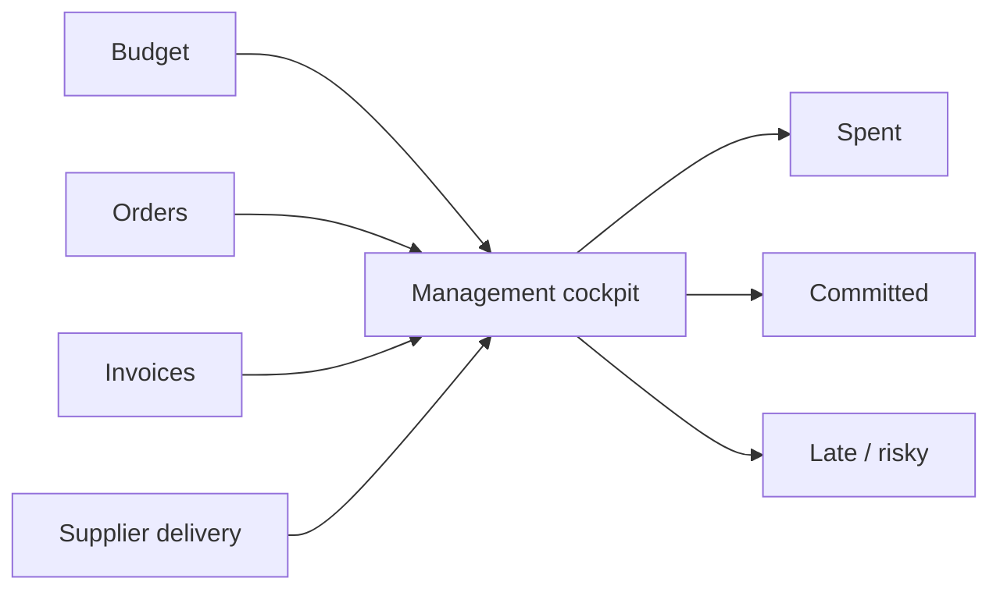
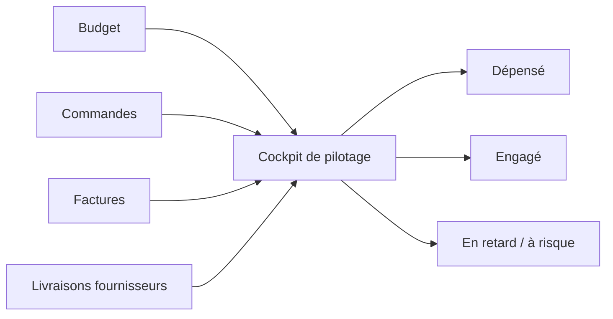

# Procurement & Financial Control Tower

[← Power BI portfolio](../README.md)

---

## 🇬🇧 English

### Understand it in 30 seconds

**Problem:** budget, spend, purchase orders, commitments and supplier performance are often split across several files or views.

**Solution:** one management cockpit that connects finance and procurement.

### How it works

### Main views

#### Overall position

#### Budget, spend and commitments

#### Orders, savings and buyers

#### Supplier reliability and risk

#### Overdue exposure and exceptions

### Technical detail

- **[Business logic →](./docs/BUSINESS_LOGIC.md)**
- **[Validation →](./docs/VALIDATION.md)**
- **[Power BI project →](./dashboard/Asterion_Procurement_Control_Tower.pbip)**

---

## 🇫🇷 Français

### Comprendre le projet en 30 secondes

**Problème :** budget, dépenses, commandes, engagements et performance fournisseurs sont souvent séparés dans plusieurs fichiers ou vues.

**Solution :** un cockpit unique qui relie finance et achats.

### Fonctionnement

### Vues principales

Les cinq captures ci-dessus répondent à cinq questions : position globale, budget, activité achats, performance fournisseurs et exceptions.

### Détail technique

- **[Logique métier →](./docs/BUSINESS_LOGIC.md)**
- **[Validation →](./docs/VALIDATION.md)**
- **[Projet Power BI →](./dashboard/Asterion_Procurement_Control_Tower.pbip)**
