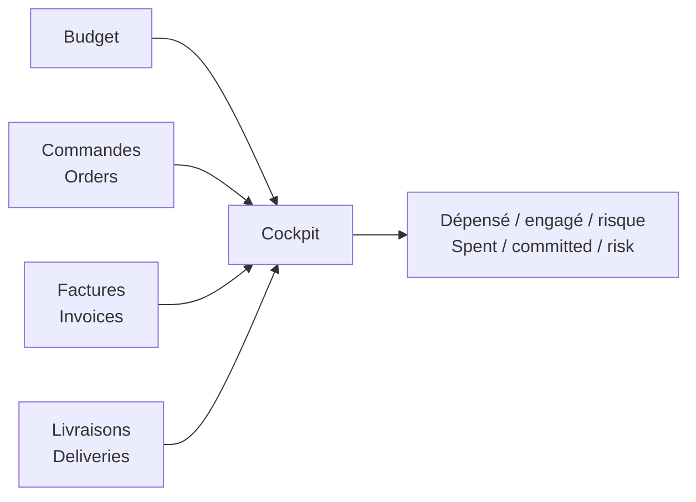
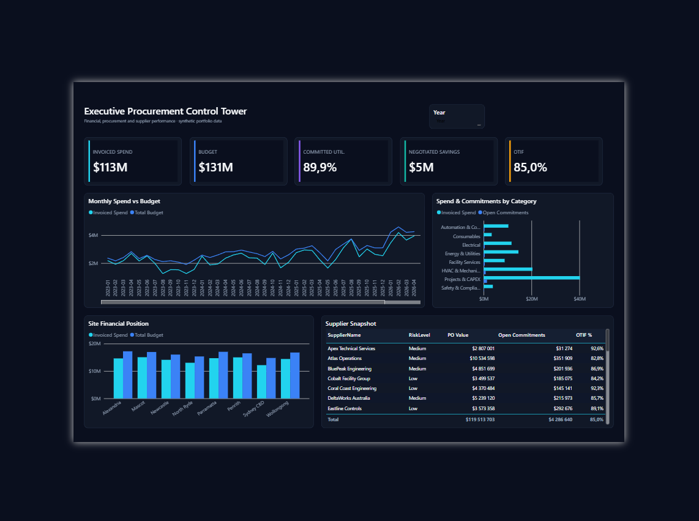
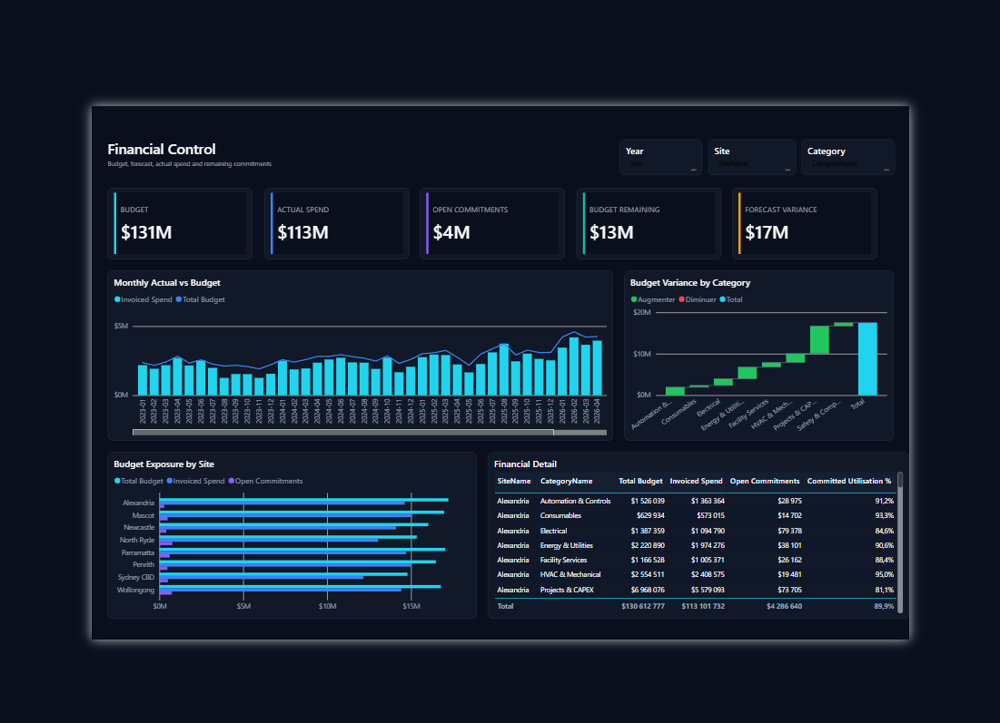
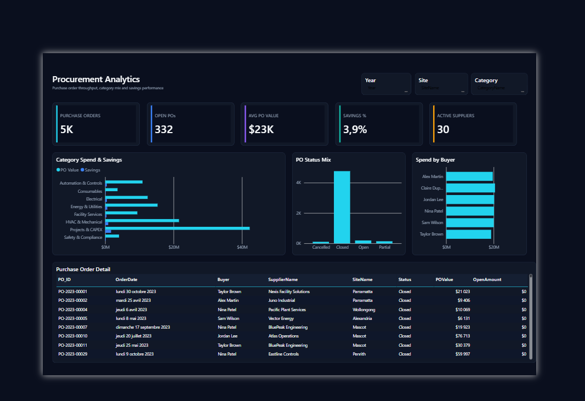
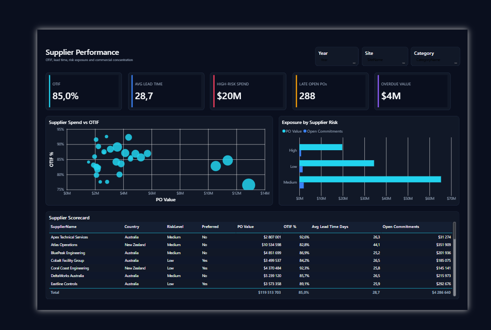
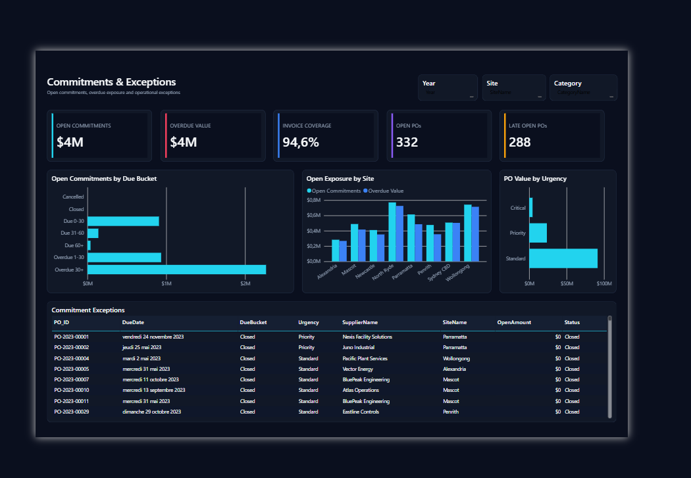
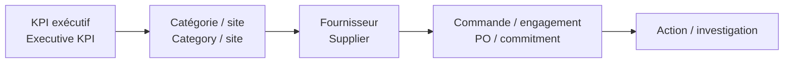
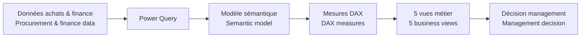

# Procurement & Financial Control Tower

[← Portfolio Power BI](../README.md)

> 🇫🇷 **Un cockpit de pilotage qui relie budget, achats, engagements et performance fournisseurs dans une seule lecture.**  
> *🇬🇧 A management cockpit connecting budget, procurement, commitments and supplier performance in one view.*

## ⚡ Comprendre en 30 secondes / Understand in 30 seconds

**🇫🇷 Problème :** les données finance et achats sont réparties dans plusieurs fichiers ou rapports, ce qui rend difficile la vision du risque réel.  
*🇬🇧 Problem: finance and procurement data is spread across several files or reports, making the real risk difficult to see.*

**🇫🇷 Solution :** réunir dépensé, engagé, budget restant, fournisseurs, retards et exceptions dans un même modèle.  
*🇬🇧 Solution: bring spend, commitments, remaining budget, suppliers, delays and exceptions into one model.*

# Parcours des écrans / Screen walkthrough

## 1. Cockpit exécutif / Executive control tower

🇫🇷 Cette page réunit les indicateurs que le management doit lire en premier : budget, dépenses facturées, engagements, économies négociées et performance OTIF. Les filtres année/site/catégorie permettent de garder la même lecture sur toute la page.  
*🇬🇧 This page brings together the indicators management should read first: budget, invoiced spend, commitments, negotiated savings and OTIF performance. Year/site/category filters keep the analysis consistent across the page.*

## 2. Contrôle financier / Financial control

🇫🇷 Cette vue répond à une question simple : après les dépenses déjà facturées et les engagements encore ouverts, quelle marge budgétaire reste réellement ? Elle compare budget, réalisé, engagements et variance.  
*🇬🇧 This view answers a simple question: after invoiced spend and still-open commitments, how much budget capacity actually remains? It compares budget, actual spend, commitments and variance.*

## 3. Analyse achats / Procurement analytics

🇫🇷 Cette page descend dans l’activité achats : volumes de commandes, commandes ouvertes, valeur moyenne, économies, catégories, acheteurs et détail transactionnel. Elle permet de comprendre ce qui explique les KPI exécutifs.  
*🇬🇧 This page moves into procurement activity: purchase-order volumes, open orders, average value, savings, categories, buyers and transaction detail. It explains what sits behind the executive KPIs.*

## 4. Performance fournisseurs / Supplier performance

🇫🇷 Le fournisseur n’est pas évalué uniquement sur le montant dépensé. La vue combine exposition financière, OTIF, délai moyen et niveau de risque afin d’identifier les fournisseurs importants mais peu fiables.  
*🇬🇧 Suppliers are not evaluated only by spend. The view combines financial exposure, OTIF, average lead time and risk level to identify important but unreliable suppliers.*

## 5. Engagements et exceptions / Commitments & exceptions

🇫🇷 Cette page met l’accent sur ce qui exige une action : engagements encore ouverts, montants échus, commandes en retard, ancienneté des engagements et cas d’exception à investiguer.  
*🇬🇧 This page focuses on what requires action: open commitments, overdue value, late purchase orders, commitment ageing and exception cases that need investigation.*

# 🔄 Du signal au détail / From signal to detail

# 🧩 Architecture analytique / Analytical architecture

🇫🇷 Le modèle utilise des dimensions communes pour que les filtres année, site et catégorie restent cohérents entre les vues.  
*🇬🇧 The model uses shared dimensions so year, site and category filters remain consistent across views.*

## 📐 Logique KPI / KPI logic

- 🇫🇷 **Dépenses facturées** = ce qui est déjà réalisé.  
  *🇬🇧 Invoiced spend = what has already been realised.*
- 🇫🇷 **Engagements ouverts** = ce qui reste financièrement engagé sur les commandes ouvertes/partielles.  
  *🇬🇧 Open commitments = remaining financial exposure on open/partial POs.*
- 🇫🇷 **Utilisation engagée** = facturé + engagé comparé au budget.  
  *🇬🇧 Committed utilisation = invoiced + committed compared with budget.*
- 🇫🇷 **OTIF** = livraison à l’heure et complète.  
  *🇬🇧 OTIF = on time and in full.*

## 🔎 Détails techniques / Technical deep dive

- [Logique métier / Business logic](./docs/BUSINESS_LOGIC.md)
- [Validation](./docs/VALIDATION.md)
- [Projet PBIP / PBIP project](./dashboard/Asterion_Procurement_Control_Tower.pbip)

🇫🇷 Les données publiques sont synthétiques et ne publient pas de données de production confidentielles.  
*🇬🇧 Public data is synthetic and does not publish confidential production records.*
