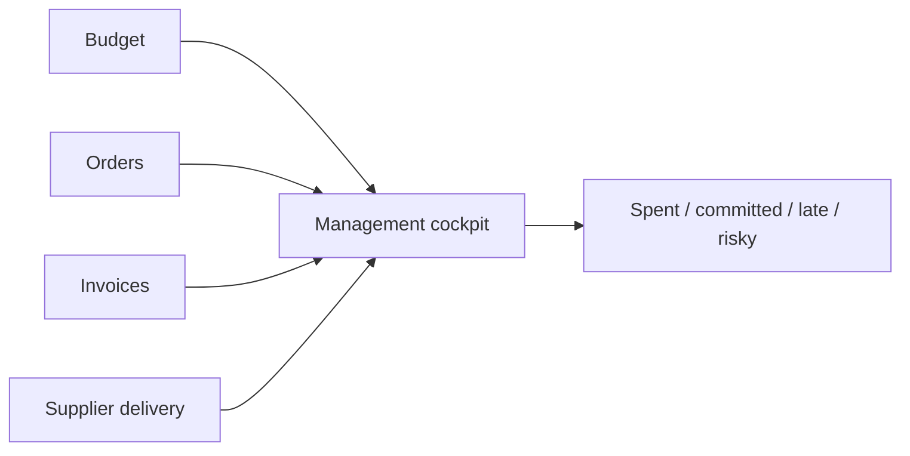
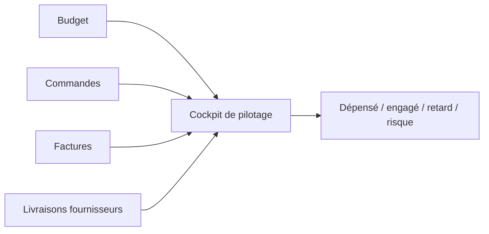

# Procurement & Financial Control Tower

[← Power BI portfolio](../README.md)

---

## 🇬🇧 English

### Understand it in 30 seconds

**Problem:** finance and procurement information is split across several views.

**Solution:** one management cockpit for budget, spend, commitments and supplier risk.

### Visual gallery — click to enlarge

<table>
<tr>
<td width="33%"> <b>Executive view</b></td>
<td width="33%"> <b>Budget control</b></td>
<td width="33%"> <b>Procurement</b></td>
</tr>
<tr>
<td> <b>Supplier risk</b></td>
<td> <b>Exceptions</b></td>
<td></td>
</tr>
</table>

### Technical detail

- **[Business logic →](./docs/BUSINESS_LOGIC.md)**
- **[Validation →](./docs/VALIDATION.md)**
- **[Power BI project →](./dashboard/Asterion_Procurement_Control_Tower.pbip)**

---

## 🇫🇷 Français

### Comprendre le projet en 30 secondes

**Problème :** les informations finance et achats sont réparties dans plusieurs vues.

**Solution :** un cockpit unique pour budget, dépenses, engagements et risques fournisseurs.

Les **5 captures ci-dessus** sont cliquables pour être ouvertes en grand.

### Détail technique

- **[Logique métier →](./docs/BUSINESS_LOGIC.md)**
- **[Validation →](./docs/VALIDATION.md)**
- **[Projet Power BI →](./dashboard/Asterion_Procurement_Control_Tower.pbip)**
