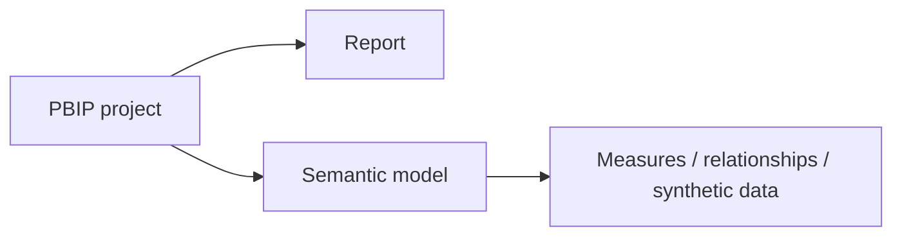
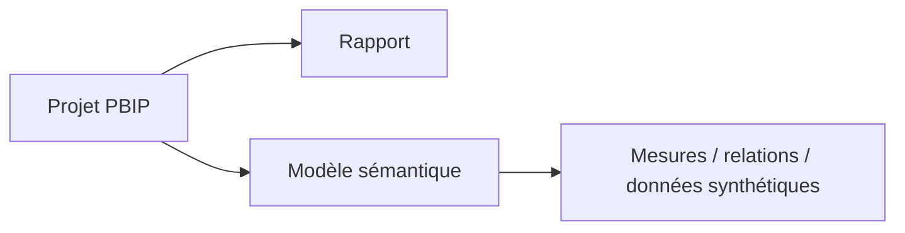

# Power BI Project Files

[← Project](../README.md)

---

## 🇬🇧 English

**Main file:** `Asterion_Procurement_Control_Tower.pbip`

---

## 🇫🇷 Français

**Fichier principal :** `Asterion_Procurement_Control_Tower.pbip`

