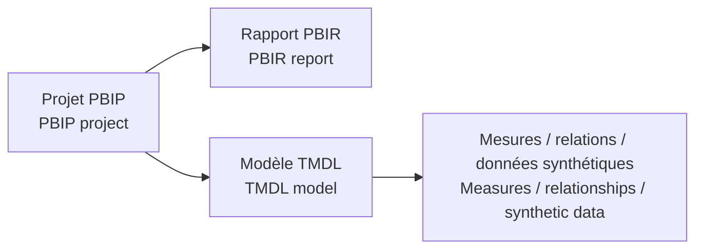

# Fichiers Power BI / Power BI Project Files

[← Projet / Project](../README.md)

**🇫🇷 Fichier principal :** `Asterion_Procurement_Control_Tower.pbip`  
*🇬🇧 Main file: `Asterion_Procurement_Control_Tower.pbip`*

🇫🇷 Le projet est portable et ne dépend pas d’un chemin local privé de production.  
*🇬🇧 The project is portable and does not depend on a private local production path.*
