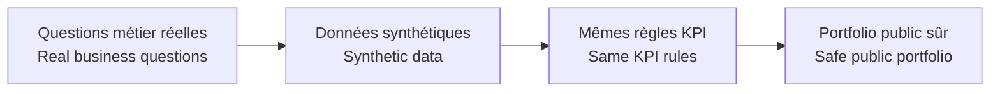

# Données / Data

[← Projet / Project](../README.md)

🇫🇷 La version publique utilise des **données synthétiques** pour reproduire des comportements achats, budgets, engagements et fournisseurs réalistes sans publier les données de production.  
*🇬🇧 The public version uses **synthetic data** to reproduce realistic procurement, budget, commitment and supplier behaviour without publishing production data.*

