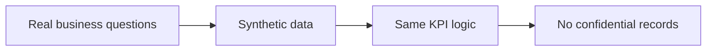
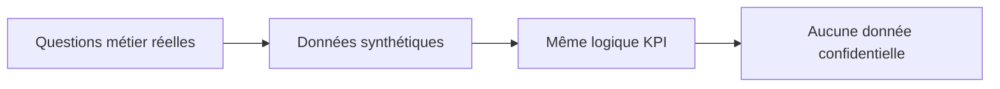

# Data

[← Project](../README.md)

---

## 🇬🇧 English

The public portfolio uses **synthetic data**.

The goal is to preserve realistic procurement and financial behaviour without publishing production data.

---

## 🇫🇷 Français

Le portfolio public utilise des **données synthétiques**.

Le but est de conserver un comportement achats / finance réaliste sans publier de données de production.
