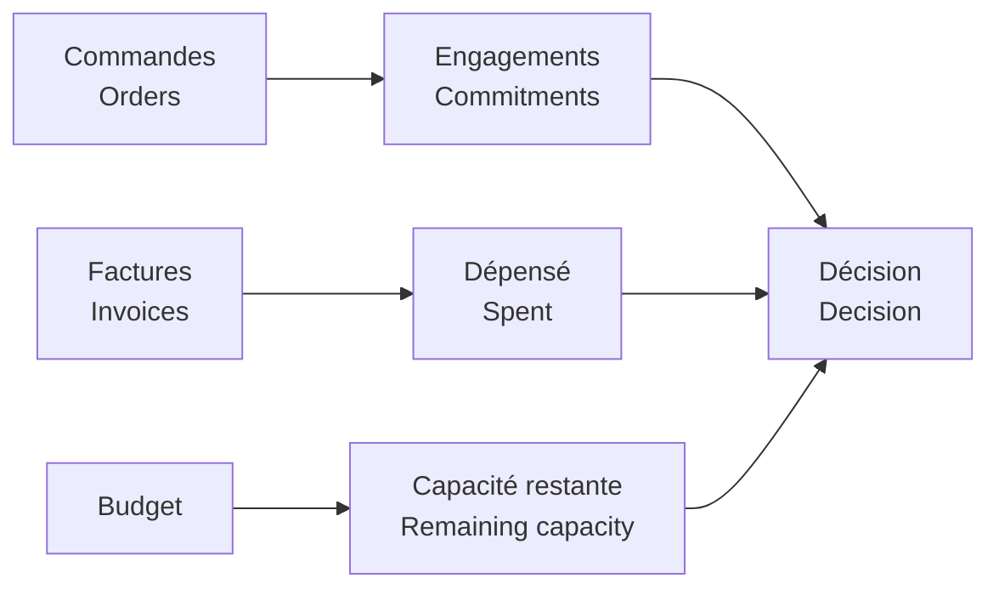

# Logique métier / Business Logic

[← Projet / Project](../README.md)

- 🇫🇷 **PO Value** = valeur totale des commandes.  
  *🇬🇧 **PO Value** = total purchase-order value.*
- 🇫🇷 **Invoiced Spend** = montant déjà facturé.  
  *🇬🇧 **Invoiced Spend** = amount already invoiced.*
- 🇫🇷 **Open Commitments** = montant restant sur les commandes ouvertes ou partielles.  
  *🇬🇧 **Open Commitments** = remaining value on open or partial purchase orders.*
- 🇫🇷 Les commandes clôturées ou annulées ne portent plus d’engagement ouvert.  
  *🇬🇧 Closed or cancelled purchase orders carry no open commitment.*
- 🇫🇷 **Committed Utilisation** compare facturé + engagé au budget.  
  *🇬🇧 **Committed Utilisation** compares invoiced + committed value with budget.*
- 🇫🇷 **OTIF** mesure les livraisons à l’heure et complètes.  
  *🇬🇧 **OTIF** measures deliveries completed on time and in full.*

🇫🇷 La règle centrale est de séparer ce qui est **déjà dépensé** de ce qui est **encore engagé**.  
*🇬🇧 The central rule is to separate what is **already spent** from what is **still committed**.*
