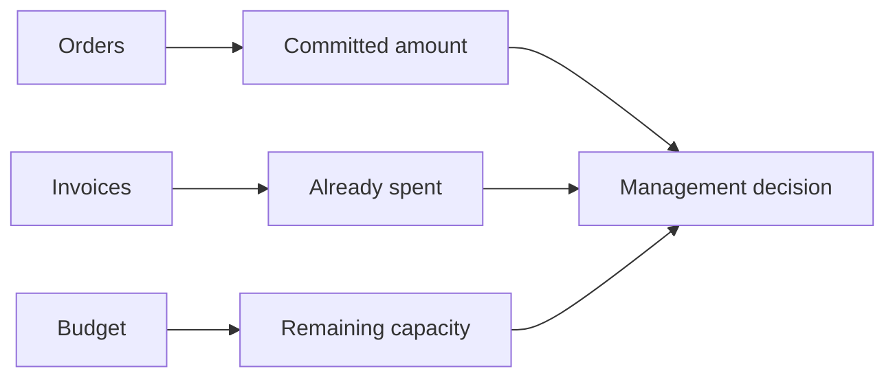
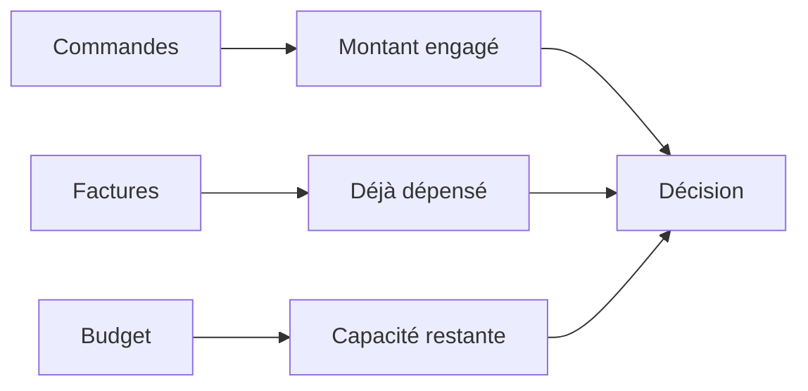

# Business Logic — Procurement & Financial Control Tower

[← Project](../README.md)

---

## 🇬🇧 English

### What the report is trying to answer

### Main rules

- **PO Value:** total purchase-order value.
- **Invoiced Spend:** amount already invoiced.
- **Open Commitments:** remaining value on open or partial orders.
- **Closed / Cancelled orders:** no remaining commitment.
- **Committed Utilisation:** invoiced spend + open commitments compared with budget.
- **OTIF:** delivery on time and in full.
- **Late Open POs:** still-open orders past their due date.
- **Overdue Value:** overdue value that is still genuinely open.

The key idea is to separate **money already spent** from **money still committed**.

---

## 🇫🇷 Français

### Ce que le rapport cherche à répondre

### Règles principales

- **Valeur commande :** montant total des commandes.
- **Dépenses facturées :** montant déjà facturé.
- **Engagements ouverts :** montant restant sur les commandes ouvertes ou partielles.
- **Commandes clôturées / annulées :** aucun engagement restant.
- **Utilisation engagée :** facturé + engagé comparé au budget.
- **OTIF :** livraison à l’heure et complète.
- **Commandes ouvertes en retard :** commandes toujours ouvertes après échéance.
- **Montant en retard :** montant encore réellement ouvert après échéance.

L’idée centrale est de séparer **ce qui est déjà dépensé** de **ce qui reste engagé**.
