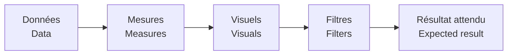

# Validation

[← Projet / Project](../README.md)

🇫🇷 Un dashboard peut sembler correct visuellement tout en contenant une mesure ou une référence incorrecte.  
*🇬🇧 A dashboard can look correct while still containing an incorrect measure or reference.*

- 🇫🇷 Vérification des pages et slicers année/site/catégorie.  
  *🇬🇧 Check report pages and year/site/category slicers.*
- 🇫🇷 Vérification que les engagements ouverts excluent clôturé/annulé.  
  *🇬🇧 Check that open commitments exclude closed/cancelled orders.*
- 🇫🇷 Vérification des mesures retard/échu sur les éléments réellement ouverts.  
  *🇬🇧 Check late/overdue measures on genuinely open items.*
- 🇫🇷 Vérification des références visuelles vers le modèle.  
  *🇬🇧 Check visual references against the semantic model.*
- 🇫🇷 Vérification de l’absence de chemin de production privé.  
  *🇬🇧 Check that no private production file path is required.*

🇫🇷 Les valeurs de référence sont synthétiques et servent uniquement aux tests du portfolio.  
*🇬🇧 Reference values are synthetic and used only for portfolio testing.*
