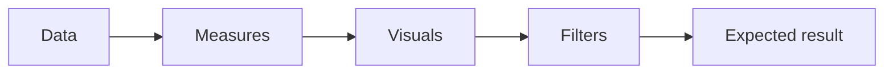
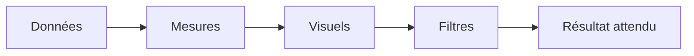

# Validation — Procurement & Financial Control Tower

[← Project](../README.md)

---

## 🇬🇧 English

### Why validate?

A dashboard can look correct while a formula or reference is wrong.

### Main checks

- report pages and filters are present;
- open commitments exclude closed / cancelled orders;
- late and overdue logic only uses genuinely open items;
- visual fields resolve to the semantic model;
- no private production file path is required.

The reference values in this repository are synthetic portfolio checks.

---

## 🇫🇷 Français

### Pourquoi valider ?

Un tableau de bord peut sembler correct alors qu’une formule ou une référence est fausse.

### Contrôles principaux

- les pages et filtres attendus existent ;
- les engagements ouverts excluent les commandes clôturées / annulées ;
- les retards concernent uniquement les éléments réellement ouverts ;
- les champs des visuels existent dans le modèle ;
- aucun chemin de production privé n’est nécessaire.

Les valeurs de référence sont des contrôles synthétiques de portfolio.
