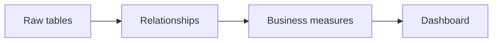
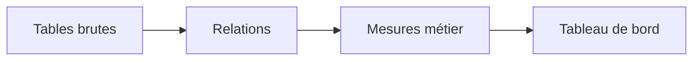

# Semantic Model

[← Project](../README.md)

---

## 🇬🇧 English

The semantic model is the layer that connects raw tables to business meaning.

Technical TMDL files are available here for deeper review.

---

## 🇫🇷 Français

Le modèle sémantique est la couche qui transforme les tables brutes en logique métier.

Les fichiers TMDL restent disponibles ici pour une analyse technique plus poussée.
