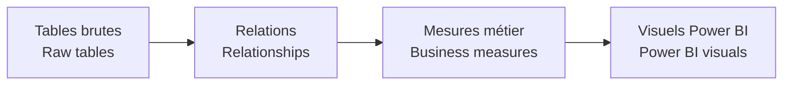

# Modèle sémantique / Semantic Model

[← Projet / Project](../README.md)

🇫🇷 Le modèle sémantique donne un sens métier commun aux données avant qu’elles soient utilisées dans les visuels.  
*🇬🇧 The semantic model gives raw data a shared business meaning before it is used in visuals.*

🇫🇷 Les extraits TMDL restent disponibles pour une revue technique plus poussée.  
*🇬🇧 TMDL extracts remain available for deeper technical review.*
