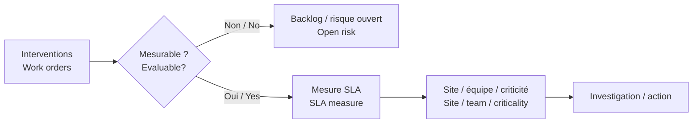
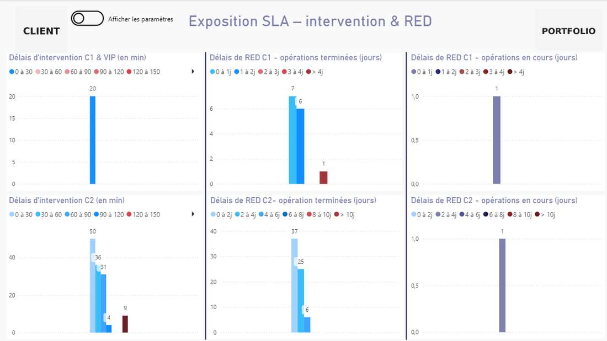
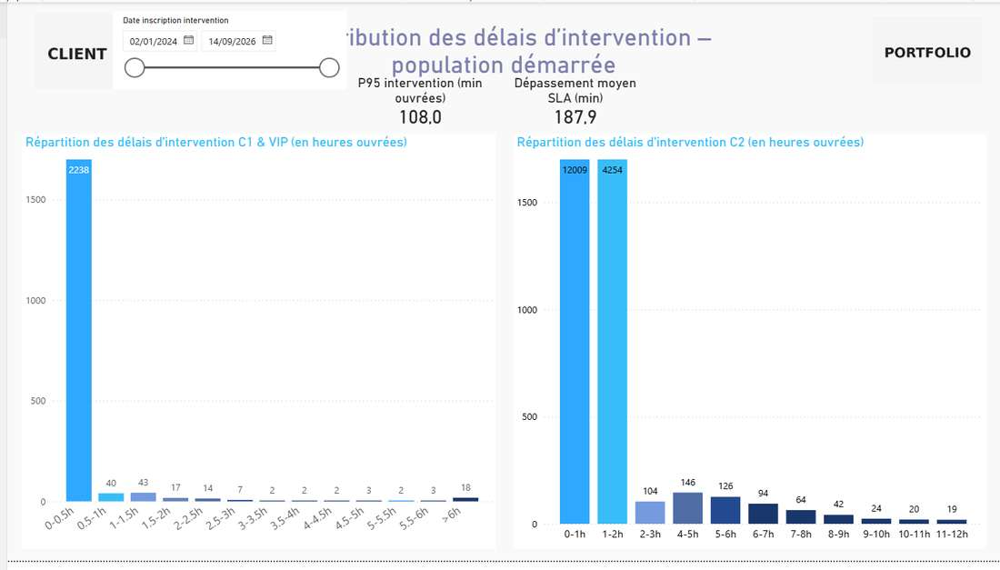
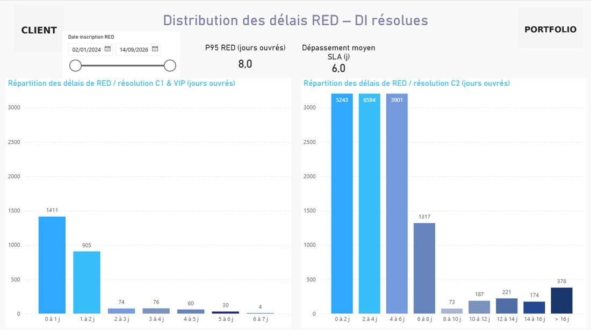
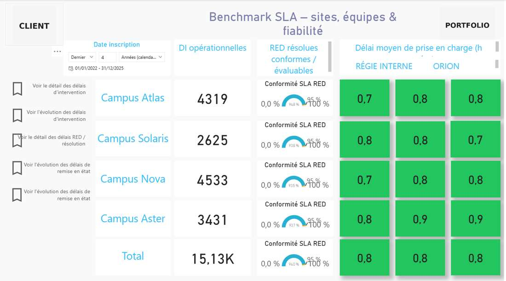
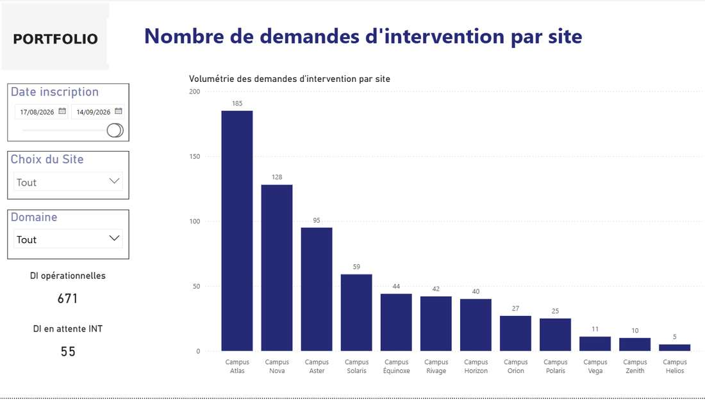
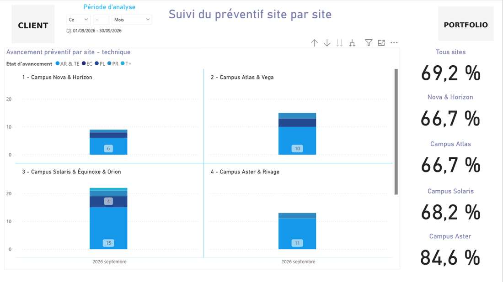
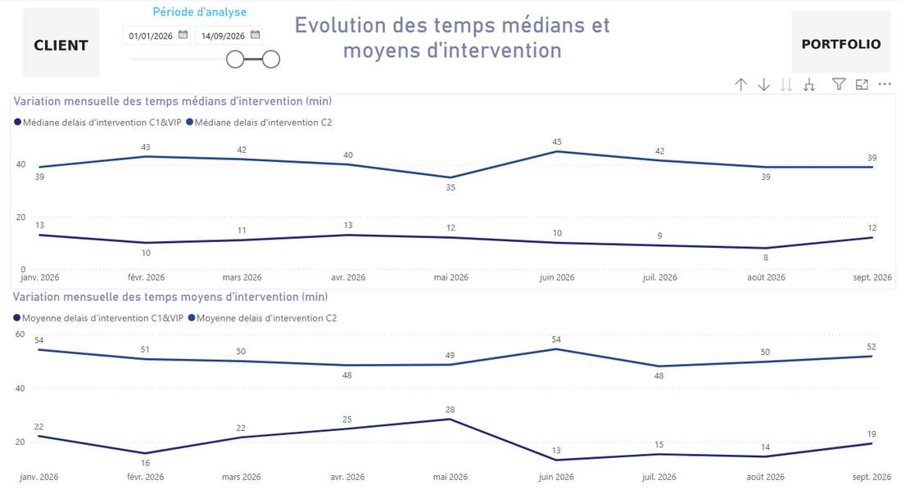
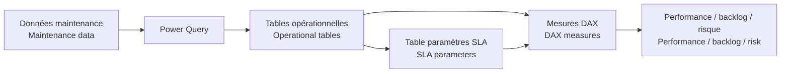
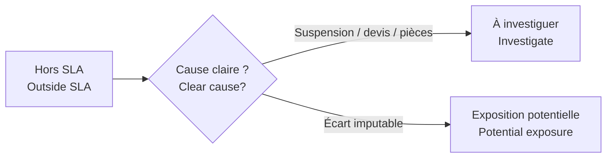

# SLA & Penalties Operations

[← Portfolio Power BI](../README.md)

> 🇫🇷 **Un tableau de bord opérationnel pour mesurer le respect des SLA, comprendre les retards et identifier le risque contractuel.**  
> *🇬🇧 An operational dashboard for measuring SLA compliance, understanding delays and identifying contractual risk.*

## ⚡ Comprendre en 30 secondes / Understand in 30 seconds

**🇫🇷 Problème :** mélanger dossiers ouverts et terminés ou regarder uniquement la moyenne peut donner une fausse lecture de la performance.  
*🇬🇧 Problem: mixing open and completed cases or looking only at averages can create a misleading performance view.*

**🇫🇷 Solution :** séparer les populations, mesurer plusieurs statistiques et relier chaque écart au site, à l’équipe, à la criticité et au contexte.  
*🇬🇧 Solution: separate populations, use several statistics and link each gap to site, team, criticality and context.*

# Parcours des écrans / Screen walkthrough

## 1. Performance SLA / SLA performance

🇫🇷 Cette vue sépare le respect des délais d’intervention et de remise en état, par criticité. Moyenne, médiane et P95 sont utilisés ensemble afin de ne pas masquer les cas très longs derrière une moyenne correcte.  
*🇬🇧 This view separates intervention and restoration compliance by criticality. Average, median and P95 are used together so very long cases are not hidden behind an acceptable average.*

## 2. Exposition contractuelle / Contractual exposure

🇫🇷 Les dossiers hors SLA sont identifiés avec leur exposition potentielle, mais un retard n’est pas automatiquement considéré comme imputable. Les suspensions, devis ou attentes de pièces restent des cas à investiguer.  
*🇬🇧 Out-of-SLA cases are identified with potential exposure, but a delay is not automatically treated as chargeable. Suspensions, quotation workflows or parts waiting remain investigation cases.*

## 3. Distribution des délais d’intervention / Intervention delay distribution

🇫🇷 La distribution montre si la mauvaise performance vient d’un problème général ou de quelques valeurs extrêmes. La segmentation par criticité permet de comparer des populations cohérentes.  
*🇬🇧 The distribution shows whether poor performance comes from a broad issue or a few extreme values. Criticality segmentation keeps comparisons meaningful.*

## 4. Distribution des délais de remise en état / Restoration delay distribution

🇫🇷 Cette vue applique la même logique à la résolution/remise en état : moyenne, médiane, P95 et longue traîne des délais.  
*🇬🇧 This view applies the same logic to restoration/resolution: average, median, P95 and the long tail of delays.*

## 5. Benchmark sites & équipes / Site & team benchmark

🇫🇷 Le benchmark compare sites et équipes avec une définition commune de la conformité. Il permet de localiser rapidement les zones sous la cible de management.  
*🇬🇧 The benchmark compares sites and teams using one consistent compliance definition. It quickly locates areas below the management target.*

## 6. Volumétrie par site / Work-order volume by site

🇫🇷 La charge de travail donne le contexte nécessaire avant de juger la performance. Un site très sollicité peut générer plus d’écarts simplement parce qu’il traite beaucoup plus de demandes.  
*🇬🇧 Workload provides context before judging performance. A heavily loaded site can generate more failures simply because it handles much more work.*

## 7. Maintenance préventive / Preventive maintenance

🇫🇷 La vue préventive complète le suivi réactif : elle permet de voir si les plans préventifs sont exécutés de façon homogène selon les sites.  
*🇬🇧 The preventive view complements reactive monitoring by showing whether preventive plans are delivered consistently across sites.*

## 8. Évolution des temps d’intervention / Intervention-time trend

🇫🇷 La tendance temporelle permet de distinguer une anomalie ponctuelle d’une dégradation durable. Moyenne et médiane sont suivies ensemble pour garder une lecture robuste.  
*🇬🇧 The time trend distinguishes a one-off anomaly from sustained deterioration. Average and median are tracked together for a more robust reading.*

# 📏 Pourquoi P95 ? / Why P95?

🇫🇷 Une moyenne correcte peut cacher une petite population extrêmement en retard. Le P95 permet de voir la longue traîne et complète la moyenne et la médiane.  
*🇬🇧 A good average can hide a small population with extreme delays. P95 exposes the long tail and complements average and median.*

# 🧩 Architecture analytique / Analytical architecture

# 🛡️ Règle d’imputabilité / Chargeability rule

## 🔎 Détails techniques / Technical deep dive

- [Logique SLA / SLA logic](./docs/SLA_LOGIC.md)
- [Validation](./docs/VALIDATION.md)
- [Projet PBIP / PBIP project](./dashboard/Portfolio_Penalites.pbip)

🇫🇷 Les seuils publics sont des hypothèses de démonstration, pas des valeurs contractuelles confidentielles.  
*🇬🇧 Public thresholds are demonstration assumptions, not confidential contractual values.*
