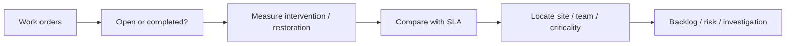
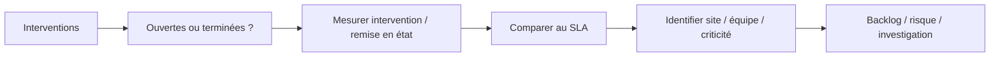

# SLA & Penalties Operations

[← Power BI portfolio](../README.md)

---

## 🇬🇧 English

### Understand it in 30 seconds

**Problem:** averages can hide serious delays, and open work can be mixed with completed work.

**Solution:** a dashboard that separates completed performance, backlog, site/team comparison and potential contractual exposure.

### How it works

### Main views

### Technical detail

- **[SLA logic →](./docs/SLA_LOGIC.md)**
- **[Validation →](./docs/VALIDATION.md)**
- **[Power BI project →](./dashboard/Portfolio_Penalites.pbip)**

---

## 🇫🇷 Français

### Comprendre le projet en 30 secondes

**Problème :** une moyenne peut cacher des retards importants et mélanger les dossiers ouverts avec les dossiers réellement terminés.

**Solution :** un tableau de bord qui sépare la performance terminée, le backlog, les comparaisons sites/équipes et l’exposition contractuelle potentielle.

### Fonctionnement

### Détail technique

- **[Logique SLA →](./docs/SLA_LOGIC.md)**
- **[Validation →](./docs/VALIDATION.md)**
- **[Projet Power BI →](./dashboard/Portfolio_Penalites.pbip)**
