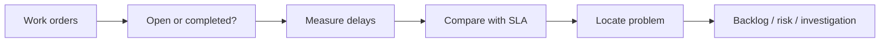
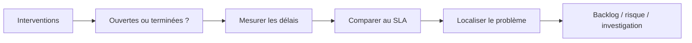

# SLA & Penalties Operations

[← Power BI portfolio](../README.md)

---

## 🇬🇧 English

### Understand it in 30 seconds

**Problem:** averages can hide serious delays, and open work can be mixed with completed work.

**Solution:** separate historical performance, backlog, site/team comparison and potential contractual exposure.

### Visual gallery — click to enlarge

<table>
<tr>
<td width="33%"> <b>SLA performance</b></td>
<td width="33%"> <b>Exposure</b></td>
<td width="33%"> <b>Intervention delays</b></td>
</tr>
<tr>
<td> <b>Restoration delays</b></td>
<td> <b>Site / team benchmark</b></td>
<td> <b>Workload</b></td>
</tr>
<tr>
<td> <b>Preventive</b></td>
<td> <b>Trend</b></td>
<td></td>
</tr>
</table>

### Technical detail

- **[SLA logic →](./docs/SLA_LOGIC.md)**
- **[Validation →](./docs/VALIDATION.md)**

---

## 🇫🇷 Français

### Comprendre le projet en 30 secondes

**Problème :** une moyenne peut cacher des retards importants et mélanger les dossiers ouverts avec les dossiers terminés.

**Solution :** séparer performance historique, backlog, comparaison sites/équipes et exposition contractuelle potentielle.

Les captures ci-dessus sont cliquables.

### Détail technique

- **[Logique SLA →](./docs/SLA_LOGIC.md)**
- **[Validation →](./docs/VALIDATION.md)**
