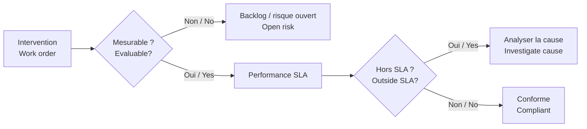

# Logique SLA / SLA Logic

[← Projet / Project](../README.md)

> 🇫🇷 **Un dossier ouvert n’est pas un dossier terminé.**  
> *🇬🇧 An open case is not a completed case.*

🇫🇷 Les suspensions, devis ou attentes de pièces sont distingués des retards automatiquement imputables.  
*🇬🇧 Suspensions, quotation workflows or parts waiting are separated from automatically chargeable delays.*

🇫🇷 Les seuils publics sont fictifs et servent à démontrer la logique paramétrable.  
*🇬🇧 Public thresholds are fictitious and demonstrate parameterised logic.*
