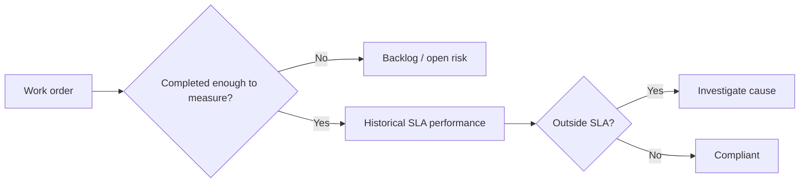
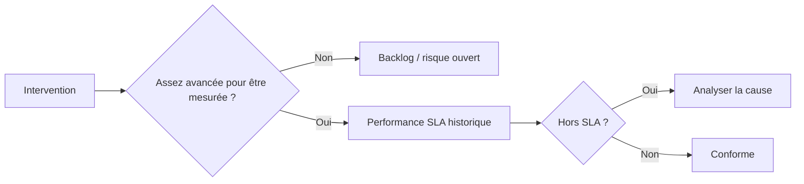

# SLA Logic

[← Project](../README.md)

---

## 🇬🇧 English

### Main idea

**Open work is not the same as completed work.**

A delay is not automatically considered chargeable. Cases such as suspension, quotation workflow or waiting for parts are flagged for investigation.

Public thresholds are demonstration assumptions, not confidential contractual values.

---

## 🇫🇷 Français

### Idée principale

**Un dossier ouvert n’est pas équivalent à un dossier terminé.**

Un retard n’est pas automatiquement imputable. Les suspensions, devis ou attentes de pièces doivent être analysés.

Les seuils publics sont des hypothèses de démonstration.
